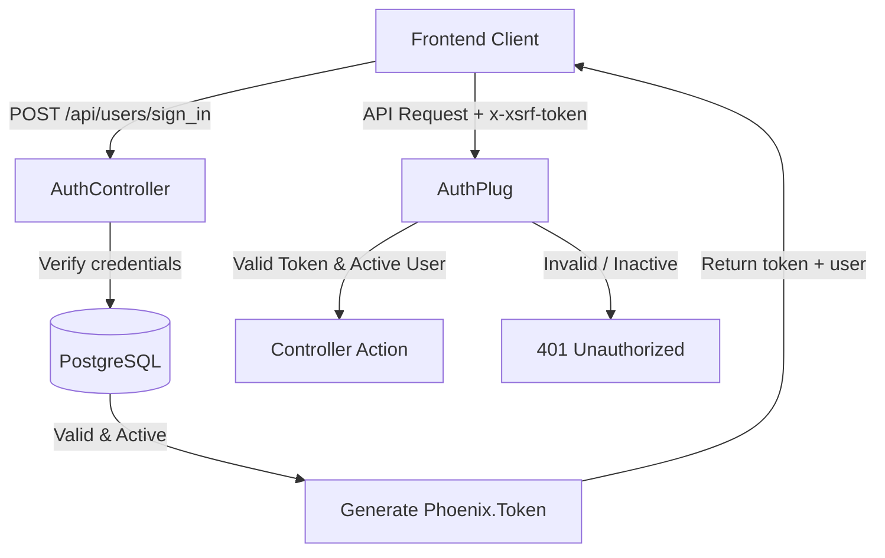

# Time Manager — API Documentation

This document provides the complete API reference for the **Time Manager** Phoenix/Elixir backend. All endpoints are served under the `/api` prefix.

---

## 1. General Principles

### Base URLs
- **Local Development (Phoenix direct)**: `http://localhost:4000/api`
- **Docker Compose (via Nginx reverse proxy)**: `http://localhost/api`
- **Mobile (iOS Capacitor)**: Configured in `src/api.js` to target the host machine IP or backend container.

### Headers
All JSON requests must include the following headers:

| Header | Value | Requirement | Description |
| :--- | :--- | :--- | :--- |
| `Content-Type` | `application/json` | Required for all POST/PUT/PATCH | Request body format |
| `Accept` | `application/json` | Recommended | Expected response format |
| `x-xsrf-token` | `<token>` | Required for all protected routes | Phoenix authentication token returned upon sign-in |

### Standard HTTP Status Codes

| Code | Status | Meaning |
| :--- | :--- | :--- |
| `200` | OK | Request succeeded. Response body contains requested data. |
| `201` | Created | Resource successfully created. |
| `204` | No Content | Request succeeded, no body returned (e.g. DELETE). |
| `400` | Bad Request | Missing required parameters or malformed payload. |
| `401` | Unauthorized | Missing, invalid, expired token or suspended account (`status: inactive`). |
| `403` | Forbidden | Authenticated, but insufficient role privileges for the requested action. |
| `404` | Not Found | Requested user, clock, or working time entry does not exist. |
| `422` | Unprocessable Entity | Validation failed on changeset (e.g. invalid email format, duplicate username). |
| `500` | Internal Server Error | Unhandled server error. |

---

## 2. Authentication Flow & Role Permissions



### Role-Based Access Control (RBAC) Matrix

| Endpoint | Method | Employee | Manager | Admin |
| :--- | :--- | :---: | :---: | :---: |
| `/api/users/sign_up` | POST | Public | Public | Public |
| `/api/users/sign_in` | POST | Public | Public | Public |
| `/api/users/sign_out` | POST | Yes | Yes | Yes |
| `/api/users` | GET | No | Assigned Team Only | All Users |
| `/api/users/:id` | GET | Self Only | Self & Assigned Team | Any User |
| `/api/users/:id` | PUT/PATCH | Self Only (profile) | Self & Team (assign) | Any User (roles/status) |
| `/api/users/:id` | DELETE | No | No | Any User |
| `/api/users/unassigned` | GET | No | Yes | Yes |
| `/api/users/:id/manager` | GET | Self Only | Self & Team | Any User |
| `/api/clocks/:userID` | GET | Self Only | Self & Assigned Team | Any User |
| `/api/clocks/:userID` | POST | Self Only | Self Only | Self & Admin |
| `/api/workingtime/:userID` | GET | Self Only | Self & Assigned Team | Any User |
| `/api/workingtime/:userID/:id` | GET | Self Only | Self & Assigned Team | Any User |
| `/api/workingtime/:userID` | POST | Self Only | Self & Assigned Team | Any User |
| `/api/workingtime/:id` | PUT | Self Only | Self & Assigned Team | Any User |
| `/api/workingtime/:id` | DELETE | Self Only | Self & Assigned Team | Any User |

---

## 3. Endpoints Catalog

### 3.1 Authentication

#### Sign In
Authenticates credentials and issues a cryptographic authentication token.

- **URL**: `/api/users/sign_in`
- **Method**: `POST`
- **Auth required**: No (Public)
- **Request Body**:
```json
{
  "username": "jane_doe",
  "password": "SecurePassword123!"
}
```
*Note: The `username` field also accepts an email address.*

- **Success Response (200 OK)**:
```json
{
  "message": "Signed in successfully",
  "token": "SFMyNTY.g2gDbQAAACQ4ZDM3ZjM5MC01MTMyLTRmMTctOTg1MS04NWVkZDYzMGFkOWZuBgDP3R35hAFiAAFRgA.uD5N3XgYnQG_gWv3G0X1VpQ7y1n...",
  "user": {
    "id": 1,
    "username": "jane_doe",
    "full_name": "Jane Doe",
    "role": "employee"
  }
}
```

- **Error Responses**:
  - `400 Bad Request`: `{"error": "Missing required fields: username, password"}`
  - `401 Unauthorized`: `{"error": "Invalid username or password"}` (also returned if account is inactive/suspended)

---

#### Sign Up (Registration)
Creates a new user account with default role `employee` and status `active`.

- **URL**: `/api/users/sign_up`
- **Method**: `POST`
- **Auth required**: No (Public)
- **Request Body**:
```json
{
  "user": {
    "username": "john_doe",
    "email": "john.doe@example.com",
    "full_name": "John Doe",
    "password": "StrongPassword123!"
  }
}
```

- **Success Response (201 Created)**:
```json
{
  "data": {
    "id": 2,
    "username": "john_doe",
    "email": "john.doe@example.com",
    "full_name": "John Doe",
    "role": "employee",
    "status": "active",
    "manager_id": null,
    "joined_at": "2026-10-15T08:30:00Z"
  }
}
```

- **Error Responses**:
  - `422 Unprocessable Entity`: Validation failure.
  ```json
  {
    "errors": {
      "email": ["has invalid format"],
      "username": ["has already been taken"],
      "password": ["should be at least 8 character(s)"]
    }
  }
  ```

---

#### Sign Out
Ends user session on client-side and validates token.

- **URL**: `/api/users/sign_out`
- **Method**: `POST`
- **Auth required**: Yes (`x-xsrf-token`)
- **Success Response (200 OK)**:
```json
{
  "message": "Signed out successfully"
}
```

---

### 3.2 Users Management

#### List Users
Returns a list of users according to caller role. Admins see all users. Managers see only their assigned team members.

- **URL**: `/api/users`
- **Method**: `GET`
- **Auth required**: Yes (`x-xsrf-token`)
- **Query Parameters (optional)**:
  - `email`: filter by exact email
  - `username`: filter by exact username
- **Success Response (200 OK)**:
```json
{
  "data": [
    {
      "id": 1,
      "username": "admin_user",
      "email": "admin@example.com",
      "full_name": "Super Admin",
      "role": "admin",
      "status": "active",
      "manager_id": null,
      "joined_at": "2026-09-01T08:00:00Z"
    },
    {
      "id": 2,
      "username": "john_doe",
      "email": "john.doe@example.com",
      "full_name": "John Doe",
      "role": "employee",
      "status": "active",
      "manager_id": 3,
      "joined_at": "2026-10-15T08:30:00Z"
    }
  ]
}
```

---

#### Get User Profile by ID
Returns details of a specific user.

- **URL**: `/api/users/:id`
- **Method**: `GET`
- **Auth required**: Yes (`x-xsrf-token`)
- **Success Response (200 OK)**:
```json
{
  "data": {
    "id": 2,
    "username": "john_doe",
    "email": "john.doe@example.com",
    "full_name": "John Doe",
    "role": "employee",
    "status": "active",
    "manager_id": 3,
    "joined_at": "2026-10-15T08:30:00Z"
  }
}
```
- **Error Responses**:
  - `403 Forbidden`: `{"error": "Forbidden"}` (Caller cannot access this user's data)
  - `404 Not Found`: `{"error": "Not Found"}`

---

#### Update User
Updates user attributes (profile, role, account status, or manager assignment).

- **URL**: `/api/users/:id`
- **Method**: `PUT` or `PATCH`
- **Auth required**: Yes (`x-xsrf-token`)
- **Request Body Examples**:

*Profile update (self or admin):*
```json
{
  "user": {
    "full_name": "Johnathan Doe"
  }
}
```

*Role update (admin only):*
```json
{
  "user": {
    "role": "manager"
  }
}
```

*Status update (admin only - suspend or activate):*
```json
{
  "user": {
    "status": "inactive"
  }
}
```

*Team assignment (manager or admin):*
```json
{
  "user": {
    "manager_id": 3
  }
}
```

- **Success Response (200 OK)**:
```json
{
  "data": {
    "id": 2,
    "username": "john_doe",
    "email": "john.doe@example.com",
    "full_name": "Johnathan Doe",
    "role": "employee",
    "status": "active",
    "manager_id": 3,
    "joined_at": "2026-10-15T08:30:00Z"
  }
}
```

---

#### Delete User
Permanently deletes a user and cascades deletion of their clocks and working-time records.

- **URL**: `/api/users/:id`
- **Method**: `DELETE`
- **Auth required**: Yes (`x-xsrf-token` - Admin only)
- **Success Response (204 No Content)**

---

#### List Unassigned Employees
Returns all active employees who are not yet assigned to any manager.

- **URL**: `/api/users/unassigned`
- **Method**: `GET`
- **Auth required**: Yes (`x-xsrf-token` - Manager or Admin)
- **Success Response (200 OK)**:
```json
{
  "data": [
    {
      "id": 4,
      "username": "unassigned_user",
      "email": "unassigned@example.com",
      "full_name": "Alice Smith",
      "role": "employee",
      "status": "active",
      "manager_id": null,
      "joined_at": "2026-10-10T11:00:00Z"
    }
  ]
}
```

---

#### Get User Manager Details
Returns the manager of the specified user (used for employee feedback routing).

- **URL**: `/api/users/:id/manager`
- **Method**: `GET`
- **Auth required**: Yes (`x-xsrf-token`)
- **Success Response (200 OK)**:
```json
{
  "data": {
    "id": 3,
    "username": "manager_bob",
    "email": "bob.manager@example.com",
    "full_name": "Bob Manager",
    "role": "manager"
  }
}
```

---

### 3.3 Clocks & Attendance

#### Get Current Clock Status
Returns the active clock state of a user.

- **URL**: `/api/clocks/:userID`
- **Method**: `GET`
- **Auth required**: Yes (`x-xsrf-token`)
- **Success Response (200 OK)**:
```json
{
  "data": {
    "id": 12,
    "time": "2026-10-15T09:00:00Z",
    "status": true,
    "state": "working"
  }
}
```

*State values:*
- `"working"`: currently clocked in and working (`status: true`).
- `"break"`: currently on break (`status: true`, `state: "break"`).
- `"off"`: currently clocked out (`status: false`, `time: null`).

---

#### Toggle Clock / Break Transition
Changes the user clock state (clock-in, clock-out, or break toggle).

- **URL**: `/api/clocks/:userID`
- **Method**: `POST`
- **Auth required**: Yes (`x-xsrf-token`)
- **Request Body Examples**:

*Clock in:*
```json
{
  "clock": {
    "time": "2026-10-15T09:00:00Z",
    "status": true
  }
}
```

*Start Break:*
```json
{
  "clock": {
    "time": "2026-10-15T12:30:00Z",
    "status": true,
    "state": "break"
  }
}
```

*Clock out:*
```json
{
  "clock": {
    "time": "2026-10-15T17:00:00Z",
    "status": false
  }
}
```

- **Success Response (200 OK)**:
```json
{
  "data": {
    "id": 12,
    "time": "2026-10-15T09:00:00Z",
    "status": true,
    "state": "working"
  }
}
```

---

### 3.4 Working Times (Historical Intervals)

#### List User Working Times
Returns completed working intervals and break sessions for a specific user.

- **URL**: `/api/workingtime/:userID`
- **Method**: `GET`
- **Auth required**: Yes (`x-xsrf-token`)
- **Query Parameters (optional)**:
  - `start`: ISO-8601 start date-time filter (`2026-10-01T00:00:00Z`)
  - `end`: ISO-8601 end date-time filter (`2026-10-31T23:59:59Z`)
- **Success Response (200 OK)**:
```json
{
  "data": [
    {
      "id": 101,
      "start": "2026-10-15T08:30:00Z",
      "end": "2026-10-15T12:30:00Z",
      "kind": "work"
    },
    {
      "id": 102,
      "start": "2026-10-15T12:30:00Z",
      "end": "2026-10-15T13:15:00Z",
      "kind": "break"
    },
    {
      "id": 103,
      "start": "2026-10-15T13:15:00Z",
      "end": "2026-10-15T17:30:00Z",
      "kind": "work"
    }
  ]
}
```

---

#### Get Single Working Time
Returns details of a specific interval.

- **URL**: `/api/workingtime/:userID/:id`
- **Method**: `GET`
- **Auth required**: Yes (`x-xsrf-token`)
- **Success Response (200 OK)**:
```json
{
  "data": {
    "id": 101,
    "start": "2026-10-15T08:30:00Z",
    "end": "2026-10-15T12:30:00Z",
    "kind": "work"
  }
}
```

---

#### Create Working Time Interval
Stores a completed work session or break period.

- **URL**: `/api/workingtime/:userID`
- **Method**: `POST`
- **Auth required**: Yes (`x-xsrf-token`)
- **Request Body**:
```json
{
  "workingtime": {
    "start": "2026-10-15T08:30:00Z",
    "end": "2026-10-15T17:00:00Z",
    "kind": "work"
  }
}
```
*`kind` accepts `"work"` or `"break"`. Defaults to `"work"`.*

- **Success Response (201 Created)**:
```json
{
  "data": {
    "id": 104,
    "start": "2026-10-15T08:30:00Z",
    "end": "2026-10-15T17:00:00Z",
    "kind": "work"
  }
}
```

---

#### Update Working Time Interval
Modifies an existing interval by ID.

- **URL**: `/api/workingtime/:id`
- **Method**: `PUT`
- **Auth required**: Yes (`x-xsrf-token`)
- **Request Body**:
```json
{
  "workingtime": {
    "start": "2026-10-15T08:45:00Z",
    "end": "2026-10-15T17:15:00Z"
  }
}
```
- **Success Response (200 OK)**

---

#### Delete Working Time Interval
Removes a specific working time record.

- **URL**: `/api/workingtime/:id`
- **Method**: `DELETE`
- **Auth required**: Yes (`x-xsrf-token`)
- **Success Response (204 No Content)**
