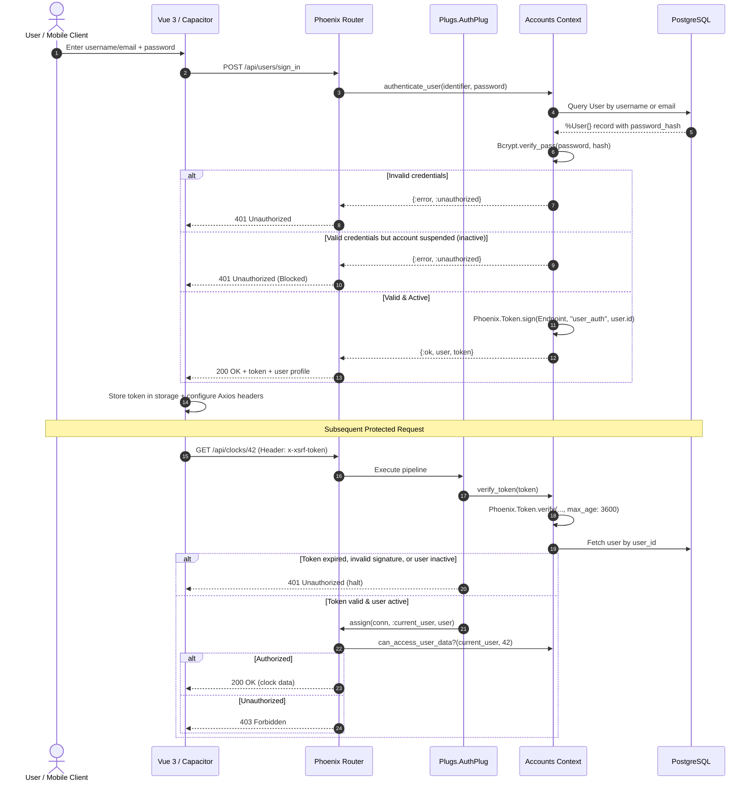

# Authentication & Access Control Guide

This guide describes the complete authentication architecture, cryptographic principles, security measures, and access control models implemented in the **Time Manager** backend and mobile frontend.

---

## 1. High-Level Architecture

The Time Manager authentication stack uses a stateless token approach signed by Phoenix (`Phoenix.Token`), combined with robust server-side account validation in PostgreSQL.



---

## 2. Password Security & Hashing

Passwords are never stored in cleartext.

### Hashing Mechanism
- **Algorithm**: `Bcrypt` (via Comeonin / bcrypt_elixir).
- **Work Factor (Cost)**: `12` (industry standard, balanced between verification speed and brute-force resistance).
- **Salt**: Unique, cryptographically secure 128-bit salt generated per password automatically.

### Defense Against Timing Attacks
When an attacker tries to enumerate existing accounts by submitting random usernames, many applications return faster for non-existent users because no password hash is computed.

In Time Manager, `Accounts.authenticate_user/2` mitigates this vulnerability using `Bcrypt.no_user_verify()`:
```elixir
cond do
  user && Bcrypt.verify_pass(password, user.password_hash) ->
    if user.status == :active do
      token = Phoenix.Token.sign(TimeManagerWeb.Endpoint, "user_auth", user.id)
      {:ok, user, token}
    else
      {:error, :unauthorized}
    end

  user ->
    {:error, :unauthorized}

  true ->
    # Prevents username enumeration through timing attacks
    Bcrypt.no_user_verify()
    {:error, :unauthorized}
end
```
Both existing and non-existing accounts take the exact same amount of time to verify, preventing timing side-channel attacks.

---

## 3. Token Generation & Verification

### Phoenix.Token Architecture
Instead of heavy stateful sessions in the database or third-party OAuth services, authentication tokens are generated with `Phoenix.Token`:
- **Cryptographic Signature**: HMAC-SHA256 based on `secret_key_base`.
- **Salt Context**: `"user_auth"`.
- **Payload**: User ID (integer).
- **Validity Duration (`max_age`)**: 1 hour (`@token_max_age_seconds: 60 * 60`).

```elixir
def verify_token(token) do
  case Phoenix.Token.verify(TimeManagerWeb.Endpoint, "user_auth", token,
         max_age: @token_max_age_seconds
       ) do
    {:ok, user_id} ->
      case get_user(user_id) do
        nil -> {:error, :user_not_found}
        %User{status: :active} = user -> {:ok, user}
        _inactive_user -> {:error, :unauthorized}
      end

    {:error, reason} ->
      {:error, reason}
  end
end
```

### Immediate Account Revocation (Suspension Check)
Unlike naive JWT implementations where a suspended user remains authenticated until token expiration, Time Manager **checks the user account status in the database on every authenticated request**:
- If an admin changes a user's status to `inactive`, any subsequent request made with an existing valid token will immediately return `401 Unauthorized` and halt execution.
- If a user is deleted, requests are immediately denied (`:user_not_found`).

---

## 4. The AuthPlug Pipeline

All protected routes pass through `TimeManagerWeb.Plugs.AuthPlug`:

```elixir
defmodule TimeManagerWeb.Plugs.AuthPlug do
  import Plug.Conn

  def init(opts), do: opts

  # Pass CORS preflight checks through directly
  def call(%Plug.Conn{method: "OPTIONS"} = conn, _opts), do: conn

  def call(conn, _opts) do
    case get_req_header(conn, "x-xsrf-token") do
      [token] ->
        case TimeManager.Accounts.verify_token(token) do
          {:ok, user} ->
            assign(conn, :current_user, user)

          {:error, _reason} ->
            unauthorized(conn)
        end

      _ ->
        unauthorized(conn)
    end
  end

  defp unauthorized(conn) do
    conn
    |> put_status(:unauthorized)
    |> Phoenix.Controller.json(%{error: "Unauthorized"})
    |> halt()
  end
end
```

### Why the Header is Named `x-xsrf-token`
Using the `x-xsrf-token` custom header guarantees:
1. Browsers enforce CORS preflight (`OPTIONS`) when cross-origin scripts attempt to send custom headers.
2. The token is never automatically submitted by the browser (unlike standard cookies), eliminating Cross-Site Request Forgery (CSRF).

---

## 5. Role-Based Access Control (RBAC) & IDOR Protection

Access control is strictly enforced on the server-side, preventing Insecure Direct Object References (IDOR).

### Role Hierarchy
1. **Admin**:
   - Workspace owner.
   - Access to all users, clocks, and working times.
   - Can change roles (`employee` <-> `manager` <-> `admin`).
   - Can activate/suspend accounts (`active` <-> `inactive`).
   - Can assign any employee to any manager.
   - Can delete users and cascade associated records.

2. **Manager**:
   - Access to own profile and time records.
   - Access to all assigned employees' clock status and working times.
   - Can assign/unassign employees to their own team.
   - Can view the list of unassigned employees.
   - *Forbidden from accessing other managers' teams or admin management.*

3. **Employee**:
   - Access to own profile.
   - Can clock in, clock out, and record breaks for themselves.
   - Can review own working time history.
   - Can retrieve their assigned manager's email to send feedback.
   - *Forbidden from viewing or mutating other employees' records.*

### Code Implementation: `Accounts.can_access_user_data?/2`
```elixir
def can_access_user_data?(%User{role: :admin}, _user_id), do: true

def can_access_user_data?(%User{id: user_id, role: role} = user, requested_id)
    when role in [:employee, :manager] do
  if to_string(user_id) == to_string(requested_id) do
    true
  else
    case user do
      %User{role: :manager, id: manager_id} ->
        case Integer.parse(to_string(requested_id)) do
          {id, ""} ->
            Repo.exists?(from u in User, where: u.id == ^id and u.manager_id == ^manager_id)

          _ ->
            false
        end

      _ ->
        false
    end
  end
end

def can_access_user_data?(_user, _user_id), do: false
```

---

## 6. Client-Side Authentication Lifecycle

### Storage & State
- Token and user role are stored in browser/mobile client storage (`sessionStorage` / `localStorage`).
- When launching the app, `router.js` reads stored session data.
- If a token is absent, unauthenticated routes automatically redirect to `/login`.

### Request Interceptor
In `src/api.js`, every outgoing request attaches the authentication token automatically:
```javascript
api.interceptors.request.use((config) => {
  const token = sessionStorage.getItem('token') || localStorage.getItem('token');
  if (token) {
    config.headers['x-xsrf-token'] = token;
  }
  return config;
});
```

### Automatic 401 Interception (Session Expiry & Suspension)
If the backend returns `401 Unauthorized` (e.g. token expired after 1 hour, or account suspended by admin):
1. Client-side storage is cleared.
2. The user is redirected to `/login` with an informative message.
