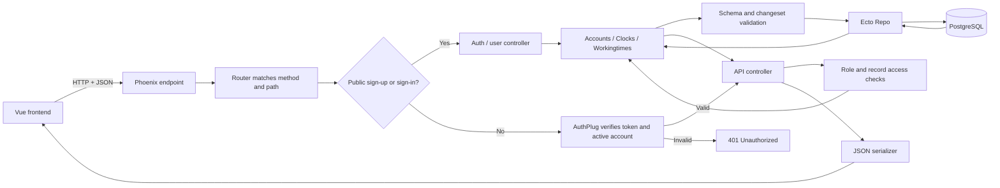

# Backend Architecture and File Guide

This guide maps the backend folders and files to their jobs. It describes the current code in `backend/project/` in plain language.

## Request flow



The backend code is grouped by responsibility:

- `lib/time_manager/` contains application startup, data contexts, schemas, and database access.
- `lib/time_manager_web/` contains the HTTP endpoint, routes, authentication plug, controllers, and JSON responses.
- `priv/repo/migrations/` records the database structure over time.
- `test/` checks context behavior and API requests.
- `config/` and the root project files control how the app is built and run.

## Full backend folder and file tree

The tree below lists the current backend project files, excluding downloaded dependencies, build output, Git internals, and other generated files.

```text
backend/project/
├── .dockerignore                         # Files excluded from Docker build contexts
├── .formatter.exs                        # Elixir formatter rules and source paths
├── .gitignore                             # Local/generated paths Git should ignore
├── AGENTS.md                              # Repository-specific development guidance
├── Dockerfile                             # Builds the production Phoenix release image
├── README.md                              # Backend setup, configuration, and run instructions
├── architecture.md                       # This architecture and file guide
├── backend_overview.md                   # Detailed backend concepts, routes, and lifecycle examples
├── entrypoint.sh                         # Waits for PostgreSQL, runs migrations, starts release
├── mix.exs                               # Project metadata, dependencies, and Mix task aliases
├── mix.lock                              # Exact dependency versions used by Mix
├── assets/                               # Source files for Phoenix's asset bundle
│   ├── css/                              # Stylesheet source files
│   │   └── app.css                       # Phoenix-side CSS entry point
│   ├── js/                               # Browser JavaScript source files
│   │   └── app.js                        # Phoenix-side JavaScript entry point
│   ├── tsconfig.json                     # TypeScript/editor configuration for assets
│   └── vendor/                           # Third-party browser scripts bundled locally
│       ├── heroicons.js                  # Bundled Heroicons asset code
│       └── topbar.js                     # Bundled topbar progress indicator code
├── config/                               # Shared and per-environment configuration
│   ├── config.exs                        # Shared app, endpoint, logger, and asset settings
│   ├── dev.exs                           # Development database and endpoint settings
│   ├── prod.exs                          # Production logging and static manifest settings
│   ├── runtime.exs                       # Runtime server, database, host, and secret settings
│   └── test.exs                          # Test database, sandbox, and endpoint settings
├── lib/                                  # Application source code
│   ├── time_manager.ex                   # Top-level application namespace documentation
│   ├── time_manager_web.ex               # Shared controller/router definitions and imports
│   ├── time_manager/                     # Core domain, startup, contexts, schemas, and Repo
│   │   ├── accounts.ex                   # User queries, roles, assignments, auth, and access rules
│   │   ├── accounts/                     # User database schema
│   │   │   └── user.ex                  # User schema and registration/profile/role changesets
│   │   ├── application.ex                # OTP supervisor starts Repo, telemetry, PubSub, and endpoint
│   │   ├── clocks.ex                     # Clock record queries and database operations
│   │   ├── clocks/                       # Clock database schema
│   │   │   └── clock.ex                 # Clock schema and input validation
│   │   ├── release.ex                    # Runs database migrations inside a release
│   │   ├── repo.ex                       # Ecto PostgreSQL Repo used for database operations
│   │   ├── workingtimes.ex               # Work/break interval queries and database operations
│   │   └── workingtimes/                 # Work/break interval database schema
│   │       └── workingtime.ex            # Working-time schema and interval validation
│   └── time_manager_web/                 # Phoenix HTTP and JSON API modules
│       ├── endpoint.ex                   # HTTP entry point, parsers, CORS, static files, and router
│       ├── gettext.ex                    # Gettext translation backend
│       ├── telemetry.ex                  # Supervised telemetry poller and metric definitions
│       ├── controllers/                  # Request actions and response serializers
│       │   ├── auth_controller.ex        # Sign-in and sign-out API actions
│       │   ├── changeset_json.ex         # Converts changeset validation errors to JSON
│       │   ├── clock_controller.ex       # Clock status reads and work/break state transitions
│       │   ├── clock_json.ex             # Shapes clock JSON responses
│       │   ├── error_json.ex             # Shapes general HTTP error JSON responses
│       │   ├── fallback_controller.ex    # Converts changeset and not-found results to responses
│       │   ├── user_controller.ex         # Registration, user, team, assignment, and admin actions
│       │   ├── user_json.ex               # Shapes public user JSON fields
│       │   ├── workingtime_controller.ex  # Work/break interval API actions and access checks
│       │   └── workingtime_json.ex        # Shapes working-time JSON responses
│       └── plugs/                        # Shared request pipeline checks
│           └── auth_plug.ex              # Verifies token and active user on protected routes
├── priv/                                 # Runtime resources, migrations, and seeds
│   ├── gettext/                          # Translation catalogs and templates
│   │   ├── errors.pot                    # Translation template for error messages
│   │   └── en/LC_MESSAGES/               # English translation catalog directory
│   │       └── errors.po                 # English translations for error messages
│   ├── repo/                             # Database setup and sample records
│   │   ├── migrations/                   # Ordered database schema changes
│   │   │   ├── .formatter.exs            # Formatter settings for migration files
│   │   │   ├── 20260922141401_create_users.exs                # Creates users table
│   │   │   ├── 20260922141946_create_clocks.exs               # Creates clock history table
│   │   │   ├── 20260922142347_create_workingtime.exs          # Creates work interval table
│   │   │   ├── 20261008110000_add_role_to_users.exs           # Adds employee/manager/admin role
│   │   │   ├── 20261008120000_add_status_to_users.exs         # Adds active/inactive account status
│   │   │   ├── 20261008130000_assign_employees_to_managers.exs # Adds manager_id relationship
│   │   │   └── 20261008140000_add_break_tracking.exs          # Adds clock state and interval kind
│   │   └── seeds.exs                     # Inserts local demo admin and manager accounts
│   └── static/                           # Static files served by Phoenix
│       ├── favicon.ico                   # Browser tab icon
│       └── robots.txt                    # Search crawler instructions
└── test/                                 # ExUnit tests and shared test support
    ├── test_helper.exs                   # Starts ExUnit and configures SQL sandbox mode
    ├── support/                          # Shared test cases and fixture helpers
    │   ├── conn_case.ex                  # Shared setup for Phoenix HTTP/controller tests
    │   ├── data_case.ex                  # Shared setup and helpers for database/context tests
    │   └── fixtures/                     # Reusable sample database records
    │       ├── accounts_fixtures.ex       # Creates users for tests
    │       ├── clocks_fixtures.ex         # Creates clock rows for tests
    │       └── workingtimes_fixtures.ex  # Creates work/break interval rows for tests
    ├── time_manager/                     # Core context tests
    │   ├── accounts_test.exs             # Tests account context operations and rules
    │   ├── clocks_test.exs                # Tests clock context database behavior
    │   └── workingtimes_test.exs          # Tests interval context database behavior
    └── time_manager_web/                 # HTTP/API request tests
        └── controllers/                  # Tests for API controller routes
            ├── clock_controller_test.exs       # Tests clock API, transitions, auth, and ownership
            ├── error_json_test.exs              # Tests common 404 and 500 JSON rendering
            ├── user_controller_test.exs         # Tests user API, roles, assignments, and auth
            └── workingtime_controller_test.exs  # Tests interval API, validation, and access rules
```

> The context modules (`accounts.ex`, `clocks.ex`, and `workingtimes.ex`) sit alongside their schema folders under `lib/time_manager/`. The shared `time_manager_web.ex` macro file sits directly under `lib/`, while the web endpoint/router/controllers live in the `lib/time_manager_web/` folder.

The root also contains `.dockerignore`, `.formatter.exs`, `.gitignore`, and `AGENTS.md`. These control Docker/Git exclusions, formatting, and repository development guidance; they are not application modules.

## What the main folders do

### `lib/time_manager/`: application and data layer

**Contexts** are the main interface for application operations. `Accounts` handles users and authorization decisions; `Clocks` handles clock history; `Workingtimes` handles completed work/break intervals. Contexts use schemas and the Repo rather than letting controllers write SQL directly.

**Schemas** describe the stored data and validate changes. Users have username, email, full name, password hash, role, active status, and optional manager assignment. Clock rows record a time and state (`working`, `break`, or `off`). Working-time rows record start, end, kind (`work` or `break`), and owner.

### `lib/time_manager_web/`: HTTP and JSON layer

The endpoint receives and parses requests. The router maps HTTP method/path pairs to controllers. Public sign-up/sign-in routes do not require a token; the authenticated route group runs `AuthPlug`, which checks the `x-xsrf-token` and rejects missing, invalid, expired, deleted-user, or inactive-user tokens. `OPTIONS` preflight requests pass through the plug. Controllers apply role and record-ownership rules where implemented, call contexts, and choose response codes. JSON modules select which fields are returned to the frontend.

### `priv/repo/migrations/`: database history

Each migration describes a database change. The original three migrations create users, clocks, and working-time tables. Later migrations add account roles, account status, manager assignment, and break tracking. Migrations run in timestamp order; an already-run migration is not reapplied just because its file changes.

### `test/`: automated checks

Context tests exercise business/data operations directly. Controller tests send HTTP requests through the router and check status codes, JSON, authentication, and permissions. `ConnCase` and `DataCase` set up isolated database sandbox ownership; fixtures make reusable test rows.

## Role and time-data rules

- A public sign-up creates an active employee without an assigned manager.
- An admin can list users, change roles/status, assign a manager to an employee, and delete another user.
- A manager can list employees assigned to them, find unassigned employees, add an unassigned employee to their own team, or remove an employee from their team. The assignment context only accepts employee accounts and manager IDs.
- An employee can access their own time data. Managers can access their own and assigned employees' clock and working-time data. Admins can access any user's time data.
- Suspending an account sets its status to `inactive`; subsequent protected requests and sign-in are rejected. The account and its historical time rows are not deleted.
- Clock state changes and completed time intervals are separate records. A clock action changes state; the working-time API stores a completed start/end interval.

## Common paths through the code

### Employee clocks in

`POST /api/clocks/:userID` → router → `AuthPlug` → `ClockController.create/2` → access check → read latest clock state → create state row through `Clocks` and `Repo` → `ClockJSON` response. The body can be `{"action":"clock"}`; omitting `action` also defaults to `clock`. An `off` state becomes `working`. A `break` action switches between `working` and `break`; trying to start a break while off clock returns HTTP 422.

### Admin changes a user's role

`PATCH /api/users/:id` → router → `AuthPlug` → `UserController.update/2` → admin role check → `Accounts.update_user_role/2` → role changeset → Repo update → `UserJSON` response. New public sign-ups remain employees; only an authorized admin can change the role. Admin updates can also change status and manager assignment. A non-null manager ID must identify a manager, and only employee accounts may have a manager.

### Employee records a completed break

When the frontend has the interval's start and end times, it sends `POST /api/workingtime/:userID` with `kind: "break"`. The controller checks access and sets `user_id` from the URL; the Workingtime changeset validates the row before the Repo stores it. The context applies a date filter only when both `start` and `end` query parameters are supplied; each must be an ISO-8601 timestamp and results must be fully contained in that range.

## Route coverage and implementation limits

The router exposes clock `GET /api/clocks/:userID` and `POST /api/clocks/:userID`. Although `ClockController` also defines `index/2`, `update/2`, and `delete/2`, the router has no routes for them. Likewise, `resources "/users"` registers `POST /api/users`, but `UserController.create/2` is commented out; use `POST /api/users/sign_up` to register.

`GET /api/users/:id` currently fetches an existing user for any authenticated caller and does not apply a role or ownership check. This differs from clock and working-time routes, which check data access. Sign-out returns a success message but does not revoke the signed token; the frontend clears its local token. The development LiveDashboard route is `/dev/dashboard` and exists only when the compile-time `:dev_routes` setting is enabled.

The API routes currently registered in `router.ex` are:

| Method and path | Authentication | Controller action |
| --- | --- | --- |
| `POST /api/users/sign_up` | Public | `UserController.sign_up` |
| `POST /api/users/sign_in` | Public | `AuthController.sign_in` |
| `POST /api/users/sign_out` | Token required | `AuthController.sign_out` |
| `GET /api/users` | Token required | `UserController.index` (admin or manager) |
| `GET /api/users/unassigned` | Token required | `UserController.unassigned` (manager only) |
| `GET /api/users/:id/manager` | Token required | `UserController.manager` (employee’s own assigned manager) |
| `GET /api/users/:id` | Token required | `UserController.show` (currently no owner/role restriction) |
| `POST /api/users` | Token required, but action is unimplemented | Generated by `resources`; `UserController.create` is commented out |
| `PUT`, `PATCH`, `DELETE /api/users/:id` | Token required | `UserController.update` / `delete` |
| `GET /api/clocks/:userID` | Token required; owner/team/admin check | `ClockController.show` |
| `POST /api/clocks/:userID` | Token required; owner/team/admin check | `ClockController.create` |
| `GET /api/workingtime/:userID` | Token required; owner/team/admin check | `WorkingtimeController.index` |
| `POST /api/workingtime/:userID` | Token required; owner/team/admin check | `WorkingtimeController.create` |
| `GET /api/workingtime/:userID/:id` | Token required; record-owner/team/admin check | `WorkingtimeController.show` |
| `PUT /api/workingtime/:id` | Token required; record-owner/team/admin check | `WorkingtimeController.update` |
| `DELETE /api/workingtime/:id` | Token required; record-owner/team/admin check | `WorkingtimeController.delete` |

The user resource registers `PUT` and `PATCH` to the same update action. Working-time updates are registered only for `PUT`; a `PATCH` route is not present.

## Useful commands

Run these from `backend/project/`:

```sh
mix setup             # Fetch dependencies, create/migrate DB, seed, and build assets
mix test              # Create/migrate test DB and run tests
mix ecto.migrate      # Apply pending database migrations
mix run priv/repo/seeds.exs  # Insert local demo accounts if absent
```

The Vue application lives separately in `frontend/project/`; this guide covers the Phoenix backend only.
