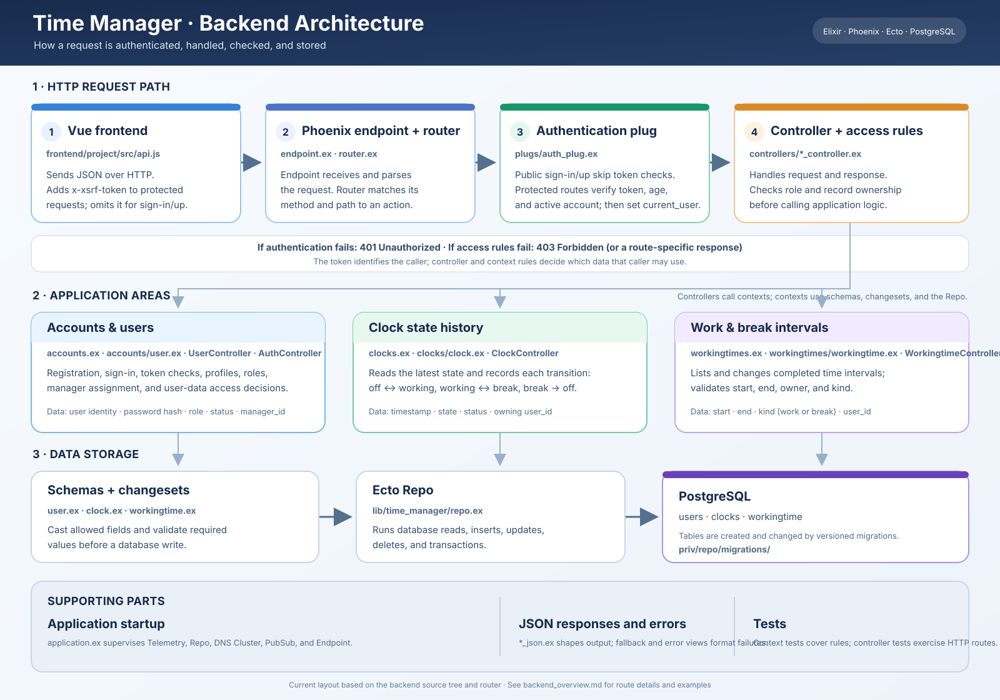
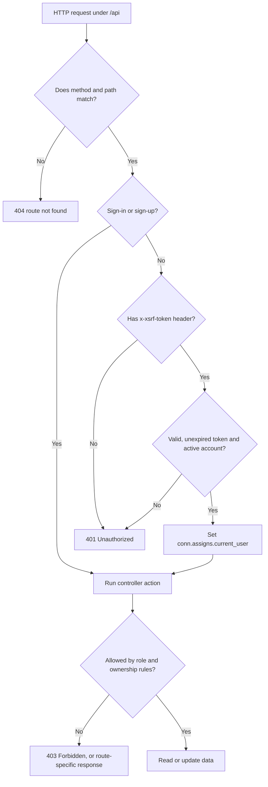
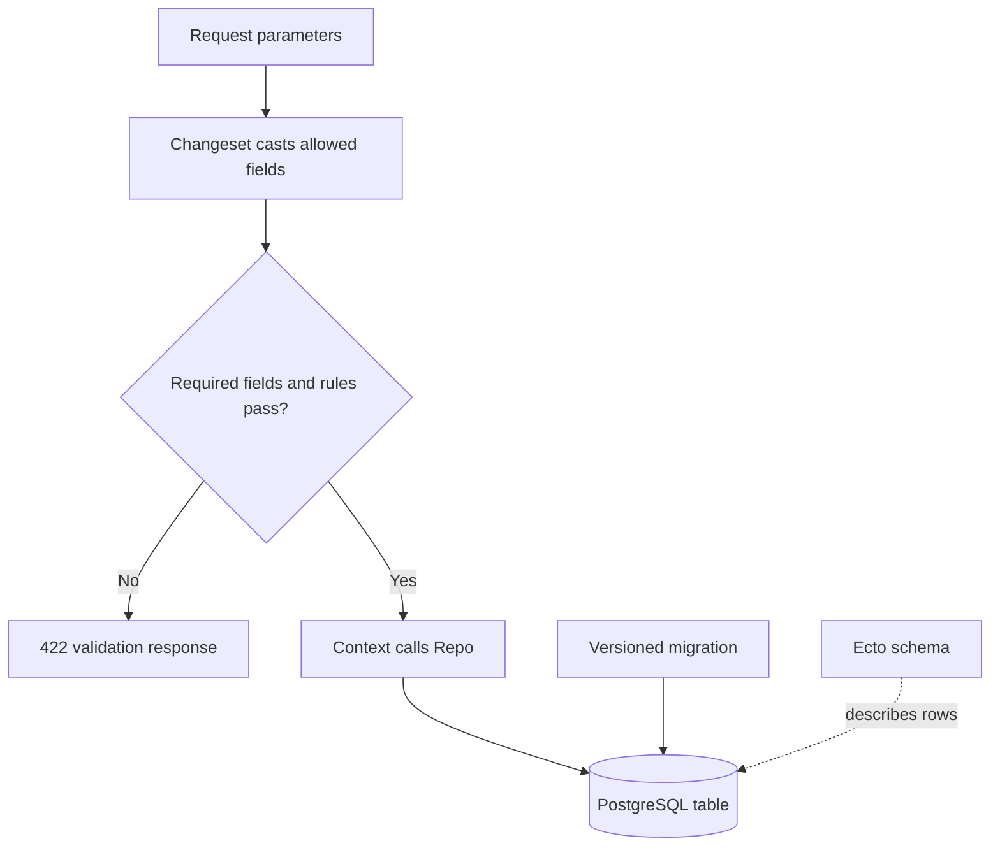
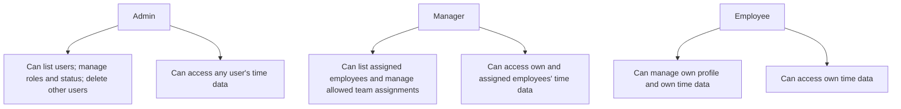
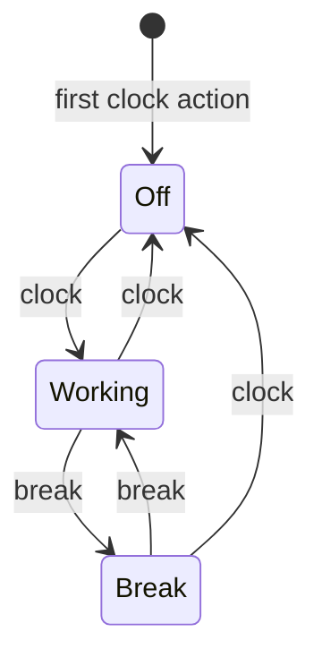
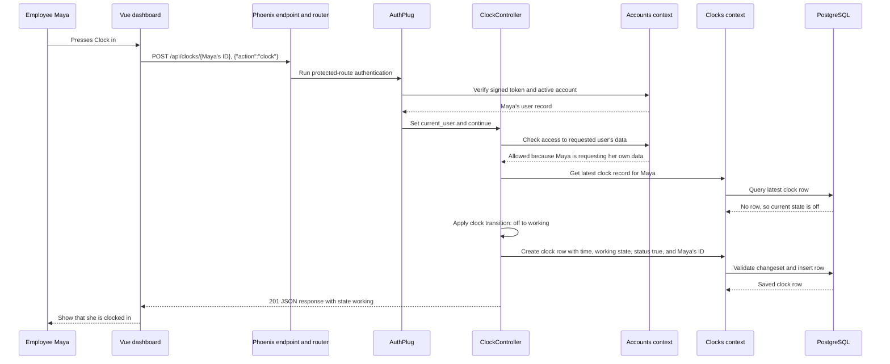
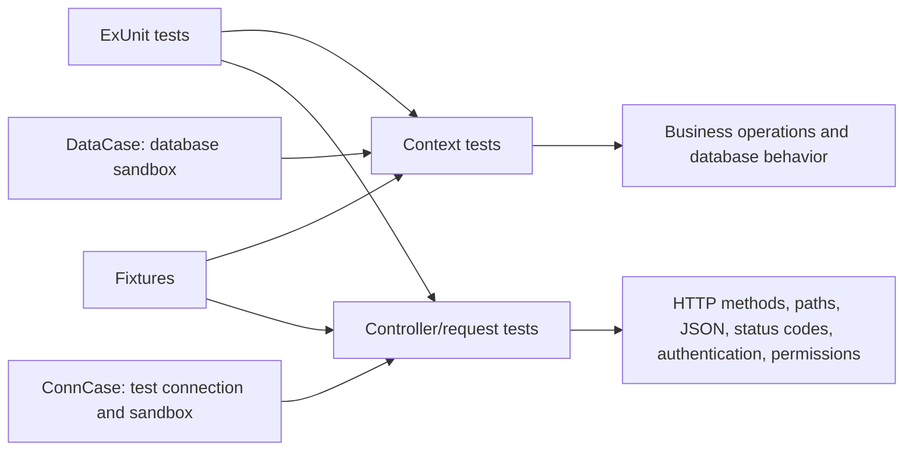

# Time Manager Backend: A Practical Guide

This guide explains how the backend works, how requests travel through it, what each API route does, how data is stored, and where the important code lives. It is written for readers who may be new to Elixir, Phoenix, or this project.

## 1. What the backend is responsible for

The backend is a JSON API built with Elixir and Phoenix. The Vue app sends it HTTP requests. The backend checks those requests, applies the application's rules, reads or changes data in PostgreSQL, and returns JSON.

The backend is responsible for:

- Creating accounts and checking sign-in credentials.
- Issuing and checking signed login tokens.
- Applying role and data-access rules.
- Recording clock-state changes and work/break intervals.
- Validating data before it is stored.
- Returning consistent JSON responses.

The browser should not connect directly to PostgreSQL. It talks to the API, and the API talks to the database.

## 2. Big-picture architecture



The diagram shows the main code layers and how they connect. The detailed route list and request examples later in this guide explain each path and rule.

In plain terms, a request passes through these steps:

1. Phoenix receives the HTTP request.
2. The router matches its method and path to a controller action.
3. A protected route checks the signed token and identifies the caller.
4. The controller checks whether that caller may perform the requested action.
5. A context function performs the application operation, using schemas and changesets to validate input.
6. Ecto's Repo reads or writes PostgreSQL.
7. A JSON serializer shapes the response, which travels back to the browser.

## 3. Where a request starts

- `lib/time_manager/application.ex` starts the supervised application services, including the database Repo and Phoenix endpoint.
- `lib/time_manager_web/endpoint.ex` is the HTTP entry point. It runs the request through Phoenix plugs and forwards it to the router.
- `lib/time_manager_web/router.ex` maps HTTP methods and URL paths to controller actions and selects the public or authenticated pipeline.
- `lib/time_manager/repo.ex` configures Ecto's connection to PostgreSQL.
- `config/` contains environment-specific settings. `config/runtime.exs` reads deployment-time settings such as the database connection and endpoint secret.

The backend project is in `backend/project/`. Mix is Elixir's build and task tool. The Docker setup for this service is also in that directory.

## 4. How route matching and authentication work

The router first applies the JSON API pipeline. Sign-in and sign-up are public because a user needs to reach them before having a token. The remaining `/api` routes also pass through the authenticated pipeline.



`TimeManagerWeb.Plugs.AuthPlug` reads the `x-xsrf-token` request header. `TimeManager.Accounts.verify_token/1` checks the Phoenix-signed token, its one-hour maximum age, and whether its user still exists and is active. For a valid token, the plug places the user record in `conn.assigns.current_user`; controllers use that value to make authorization decisions.

The frontend API helper in `frontend/project/src/api.js` attaches the saved token to protected requests and omits it for sign-in and sign-up. The token is a signed identifier, not a server-side session record.

Signing out currently returns a success message but does not revoke the token on the backend. The frontend clears its saved token; a copied token can still be used until it expires, unless the account is disabled or deleted.

## 5. The main code layers

Phoenix divides work into layers so HTTP handling, application rules, and database access are not all mixed together.

| Layer | What it does | Examples |
| --- | --- | --- |
| Router | Chooses the action based on method and path; selects plugs | `lib/time_manager_web/router.ex` |
| Plug | Runs shared request checks | `lib/time_manager_web/plugs/auth_plug.ex` |
| Controller | Reads request parameters, applies access rules, chooses response status | `lib/time_manager_web/controllers/` |
| Context | Provides operations for one part of the application | `accounts.ex`, `clocks.ex`, `workingtimes.ex` |
| Schema and changeset | Describes a database row and validates incoming values | `accounts/user.ex`, `clocks/clock.ex`, `workingtimes/workingtime.ex` |
| Repo | Runs database queries and writes | `lib/time_manager/repo.ex` |
| JSON serializer | Chooses which fields are returned to clients | `*_json.ex` in the controllers directory |

For example, a controller should not build a raw SQL statement to create a user. It calls the Accounts context; the User schema checks the values; the Repo saves the record; and the User JSON serializer shapes the response.

## 6. Data model and database changes

An Ecto schema maps an Elixir struct to a database table. A changeset casts incoming values into the right types and validates required fields and allowed values before a database write.



Current main tables:

| Table | Schema | Purpose |
| --- | --- | --- |
| `users` | `lib/time_manager/accounts/user.ex` | Account identity, password hash, role, status, and manager assignment |
| `clocks` | `lib/time_manager/clocks/clock.ex` | Time-stamped history of clock-state changes |
| `workingtime` | `lib/time_manager/workingtimes/workingtime.ex` | Completed work or break intervals with start and end times |

The `clocks` and `workingtime` rows have a `user_id` that identifies the user they belong to. A user's `manager_id` points back to another row in `users`.

Migrations in `priv/repo/migrations/` are the database's change history. They create tables and add fields such as roles, account status, manager assignment, and break tracking. Once a migration has run in an environment, changing that old migration file does not change that database; normally a new migration records the next change.

## 7. Users, roles, and account rules

The user schema includes:

- `username`, `email`, and `full_name` for account identity.
- `password`, a virtual field used as incoming input and not stored as plain text.
- `password_hash`, the stored Bcrypt hash.
- `role`: `employee`, `manager`, or `admin`.
- `status`: `active` or `inactive`.
- `manager_id`: optional ID of the manager assigned to an employee.
- `inserted_at` and `updated_at`: timestamps maintained by Ecto.



The backend makes these decisions. Hiding a button or page in the Vue app is not a substitute for an API permission check.

User update rules in `UserController.update/2` are specific:

- An admin can change role/status/manager assignment for another account, subject to account validation. An admin cannot deactivate their own account.
- A manager can assign an unassigned employee to themselves or remove an employee from their own team. They cannot use this route to edit another profile.
- A user can update their own profile. The controller removes `role`, `status`, and `manager_id` from self-service changes.
- Other profile updates are forbidden.
- Only an admin can delete a user, and an admin cannot delete their own account. Deleting a user and their clock/working-time records happens in a database transaction.

## 8. Authentication lifecycle

```mermaid
sequenceDiagram
  participant UI as Vue sign-in screen
  participant Router as Phoenix router
  participant Auth as AuthController
  participant Accounts as Accounts context
  participant DB as PostgreSQL
  UI->>Router: POST /api/users/sign_in with username and password
  Router->>Auth: Public route; no token needed
  Auth->>Accounts: authenticate_user(username, password)
  Accounts->>DB: Find username or email
  DB-->>Accounts: User and password hash
  Accounts->>Accounts: Verify Bcrypt hash and active status
  Accounts-->>Auth: User and signed token, or unauthorized
  Auth-->>UI: Token and user ID, name, username, and role
  UI->>UI: Save token for later API requests
  UI->>Router: Later request with x-xsrf-token header
  Router->>Router: AuthPlug verifies token and loads active user
```

Sign-in accepts either username or email as the identifier. Wrong credentials and inactive accounts are rejected. A successful response contains a signed token and the user's basic identity and role. The token expires after one hour.

Sign-up creates an employee account by default. The user changeset requires username, email, full name, and password; it validates the email shape and hashes the password before saving.

## 9. Clock states and work/break intervals

The clock endpoint records a state transition, not a complete timesheet interval. It looks up the user's latest clock record and uses that state to decide what the next state should be.

| Requested action | Current state | Result |
| --- | --- | --- |
| `clock` | `off` or no prior record | `working` |
| `clock` | `working` | `off` |
| `clock` | `break` | `off` |
| `break` | `working` | `break` |
| `break` | `break` | `working` |
| `break` | `off` or no prior record | Rejected with HTTP 422 |



Each successful transition adds a row to `clocks`, with a timestamp, the new `state`, a compatibility boolean `status`, and the owning `user_id`. `status` is true only in the `working` state. The latest record represents the current state; older rows provide transition history.

Completed intervals are stored separately in `workingtime`. Each has a start, end, kind (`work` or `break`), and owner. These interval records are what reports and summaries can total. The clock endpoint does not itself close or create a working-time interval; the frontend sends a separate working-time request when it has an interval to record.

## 10. API route reference

Every API path below is prefixed with `/api`. Sign-in and sign-up are public. The other listed routes require `x-xsrf-token`.

### Account and authentication routes

| Method | Path | Controller action | Access and behavior |
| --- | --- | --- | --- |
| `POST` | `/users/sign_up` | `UserController.sign_up` | Public. Creates an employee account; returns `201` or validation errors. Accepts a `user` object or flat user fields. |
| `POST` | `/users/sign_in` | `AuthController.sign_in` | Public. Accepts `username` and `password`; returns token and identity or `401`. Missing fields return `400`. |
| `POST` | `/users/sign_out` | `AuthController.sign_out` | Authenticated. Returns a success message; does not revoke the token. |
| `GET` | `/users` | `UserController.index` | Admin sees filtered user list; manager sees assigned employees; employee is forbidden. Admin filters include `email` and `username`. |
| `GET` | `/users/unassigned` | `UserController.unassigned` | Authenticated manager only. Lists unassigned employees. |
| `GET` | `/users/:id/manager` | `UserController.manager` | Employee can view their own assigned manager. Returns `404` if they have no valid manager. Other access is forbidden. |
| `GET` | `/users/:id` | `UserController.show` | Authenticated. Returns the requested user. Current implementation does not restrict the requested ID by role or ownership. |
| `PATCH` / `PUT` | `/users/:id` | `UserController.update` | Authenticated; applies the role-specific update rules described above. |
| `DELETE` | `/users/:id` | `UserController.delete` | Admin only; cannot delete the acting admin. Removes related time rows transactionally. |

`resources "/users"` also registers `POST /users`, which maps to `UserController.create/2`. That action is commented out in the controller, so this generated route is currently unsupported and should not be used. Account creation is implemented at `/users/sign_up`.

### Clock routes

| Method | Path | Controller action | Access and behavior |
| --- | --- | --- | --- |
| `GET` | `/clocks/:userID` | `ClockController.show` | Caller can read their own clock, a manager can read an assigned employee's clock, and an admin can read any clock. Returns `data: null` if there is no clock row. |
| `POST` | `/clocks/:userID` | `ClockController.create` | Same user-data access rule. Body `action` is `clock` or `break`; creates the next state row or returns `403`/`422`. |

### Working-time routes

| Method | Path | Controller action | Access and behavior |
| --- | --- | --- | --- |
| `GET` | `/workingtime/:userID` | `WorkingtimeController.index` | Caller can read own records, manager can read assigned employee records, admin can read any. Optional `start` and `end` query values filter intervals when both are present. |
| `POST` | `/workingtime/:userID` | `WorkingtimeController.create` | Same user-data access rule. Creates an interval; `start`, `end`, and `kind` are validated. |
| `GET` | `/workingtime/:userID/:id` | `WorkingtimeController.show` | Looks up the record by ID and checks access using that record's owner. The route's `userID` segment is not used by the action. |
| `PUT` / `PATCH` | `/workingtime/:id` | `WorkingtimeController.update` | Caller must have access to the record owner's time data. |
| `DELETE` | `/workingtime/:id` | `WorkingtimeController.delete` | Caller must have access to the record owner's time data. |

### Development-only route

When `dev_routes` is enabled, Phoenix LiveDashboard is exposed at `/dev/dashboard`. It uses a browser session/CSRF pipeline rather than the JSON API token pipeline. It should be treated as a development tool and protected before exposure in a production deployment.

## 11. Example request: clock in

The frontend sends the action and its saved token:

```http
POST /api/clocks/42
Content-Type: application/json
x-xsrf-token: <signed-token>

{"action":"clock"}
```

If user `42` is currently off the clock and the caller has access to that user's time data, the controller creates a clock row and returns a response shaped like:

```json
{
  "data": {
    "id": 101,
    "time": "2026-10-09T08:30:00Z",
    "status": true,
    "state": "working"
  }
}
```

The serializer returns only the listed fields; it does not expose internal schema fields such as `user_id` or timestamps.

### Full lifecycle: an employee clocks in

Assume employee Maya is signed in, her account is active, and her current clock state is `off` (or she has no clock rows yet).



The same path applies if Maya has previous clock rows: the controller uses the latest row to determine the current state. If she is already working, another `action: "clock"` changes the state to `off`. If she asks to start a break while off, the request is rejected with `422` and no new clock row is created.

## 12. Validation, status codes, and errors

Changesets validate user, clock, and working-time writes. For example, user registration requires identity fields and a password; clock rows require a time, status, and user ID; working-time rows require start, end, user ID, and an allowed kind.

Common responses include:

| Status | Meaning in this API |
| --- | --- |
| `200` | Read or update succeeded; also sign-in/sign-out success |
| `201` | A user, clock transition, or working-time row was created |
| `204` | A delete succeeded and has no response body |
| `400` | Required sign-in fields were missing |
| `401` | Token missing/invalid/expired, or credentials rejected |
| `403` | Signed-in caller lacks permission for the action/data |
| `404` | Route or supported resource lookup was not found |
| `422` | Submitted values failed validation or a clock transition is not allowed |

Exact response bodies differ by action. Validation errors are translated by the fallback controller and changeset JSON view; controllers also return small `error` messages for authentication and authorization failures.

### Full lifecycle: an admin suspends an employee

Assume admin Alex has a valid token and suspends employee Maya by updating her status to `inactive`.

```mermaid
sequenceDiagram
  participant Alex as Admin
  participant Maya as Employee
  participant UI as Vue admin screen
  participant API as Phoenix endpoint and router
  participant Plug as AuthPlug
  participant Controller as UserController
  participant Accounts as Accounts context
  participant DB as PostgreSQL
  Alex->>UI: Selects Maya and chooses Suspend
  UI->>API: PATCH /api/users/{Maya's ID}, {"user":{"status":"inactive"}}
  API->>Plug: Check Alex's token
  Plug-->>Controller: Assign active Alex as current_user
  Controller->>Controller: Check caller role; Alex is admin
  Controller->>Accounts: Load Maya and update her status
  Accounts->>DB: Apply role_changeset and save status inactive
  DB-->>Accounts: Updated Maya record
  Controller-->>UI: 200 JSON response showing inactive status
  UI-->>Alex: Show the updated account status
  Note over Maya,DB: Maya's already-issued token is rejected on her next protected API request
```

The suspension does not need to find and delete Maya's token. On each protected request, `AuthPlug` asks `Accounts.verify_token/1` to verify the signed token and reload the account. The token can still be correctly signed and not yet expired, but the account status check rejects an inactive user with `401 Unauthorized`; the controller does not run. If Maya tries signing in again, `authenticate_user/2` also rejects the inactive account. Her account and historical clock/working-time data remain in the database; suspension changes the account status rather than deleting it.

## 13. How to read the tests

The `test/` directory has two main kinds of tests:



- `test/time_manager/` tests the Accounts, Clocks, and Workingtimes context functions and database behavior.
- `test/time_manager_web/controllers/` sends HTTP requests through the router and checks route behavior, JSON responses, status codes, authentication, and permissions.
- `test/support/fixtures/` creates reusable test users and time records.
- `test/support/conn_case.ex` provides a Phoenix test connection and shared database sandbox setup for request tests.
- `test/support/data_case.ex` provides database sandbox setup for context tests.

Controller tests are API-level tests, but they run inside the backend test environment. They do not start the Vue application or test the UI in a real browser. A passing suite shows the tested behaviors worked; it does not prove every possible input or scenario is covered. The route tests are especially important when changing authentication, ownership rules, or state transitions.

Run from `backend/project/`:

```sh
mix test
mix test test/time_manager/accounts_test.exs
mix ecto.migrate
mix run priv/repo/seeds.exs
```

Tests use the test database configuration in `config/test.exs`. They should not be pointed at a development or production database.

## 14. Main files by responsibility

| Concern | Files |
| --- | --- |
| Application startup and HTTP | `lib/time_manager/application.ex`, `lib/time_manager_web/endpoint.ex`, `lib/time_manager_web/router.ex` |
| Authentication | `lib/time_manager_web/plugs/auth_plug.ex`, `lib/time_manager_web/controllers/auth_controller.ex`, authentication functions in `lib/time_manager/accounts.ex` |
| Users and permissions | `lib/time_manager/accounts.ex`, `lib/time_manager/accounts/user.ex`, `lib/time_manager_web/controllers/user_controller.ex`, `user_json.ex` |
| Clock status | `lib/time_manager/clocks.ex`, `lib/time_manager/clocks/clock.ex`, `clock_controller.ex`, `clock_json.ex` |
| Work/break intervals | `lib/time_manager/workingtimes.ex`, `lib/time_manager/workingtimes/workingtime.ex`, `workingtime_controller.ex`, `workingtime_json.ex` |
| Database structure and sample data | `priv/repo/migrations/`, `priv/repo/seeds.exs` |
| Errors and validation output | `fallback_controller.ex`, `changeset_json.ex`, `error_json.ex` |
| Tests | `test/time_manager/`, `test/time_manager_web/controllers/`, `test/support/` |
| Frontend API connection | `frontend/project/src/api.js` |
