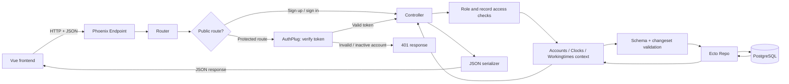
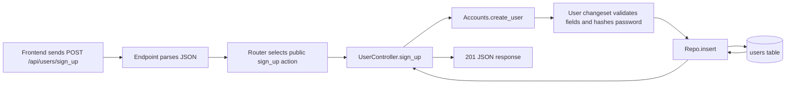
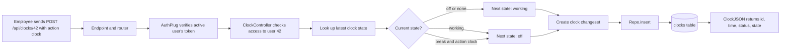
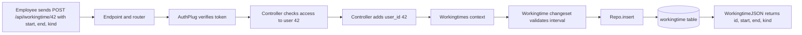

# Backend Overview

This document explains the backend architecture of the Time Manager Phoenix app in simple terms.

---

## 1. High-level idea

The backend is a Phoenix + Ecto application.

A typical request follows this pattern:



In plain language:

- the request enters the app
- the router matches the URL
- the controller handles the request
- the context does business logic
- the schema validates data
- the repo writes or reads the database
- the controller returns JSON to the frontend

---

## 2. The app starts here

### lib/time_manager/application.ex

This is the application startup file.

It starts:

- telemetry
- the database repo
- DNS cluster discovery
- PubSub
- the Phoenix endpoint

This is the main boot file for the backend.

---

## 3. The database connection

### lib/time_manager/repo.ex

This file sets up Ecto to talk to PostgreSQL.

It is the connection between Elixir code and the database.

```elixir
defmodule TimeManager.Repo do
  use Ecto.Repo,
    otp_app: :time_manager,
    adapter: Ecto.Adapters.Postgres
end
```

This is the single access point for database operations.

---

## 4. The database files

The database tables are created in migration files under:

### priv/repo/migrations

The important migrations are:

- 20260922141401_create_users.exs
- 20260922141946_create_clocks.exs
- 20260922142347_create_workingtime.exs
- 20261008110000_add_role_to_users.exs
- 20261008120000_add_status_to_users.exs
- 20261008130000_assign_employees_to_managers.exs
- 20261008140000_add_break_tracking.exs

These define the tables:

- `users`
- `clocks`
- `workingtime`

The migrations create the actual database structure. The later migrations add employee/manager/admin roles, active/inactive account status, employee-to-manager assignment, and work/break state fields. A migration is the database's versioned change history; editing an old migration does not update a database that already ran it.

---

## 5. Schemas: Elixir versions of database tables

### lib/time_manager/accounts/user.ex

This file defines the `users` schema.

The current account has:

- `username`
- `email`
- `full_name`
- `password` as temporary input only (virtual; not stored)
- `password_hash` for the Bcrypt-encrypted password
- `role`: `employee`, `manager`, or `admin` (new accounts default to employee)
- `status`: `active` or `inactive` (accounts default to active)
- `manager_id`: optional ID of the manager assigned to this employee
- timestamps

The schema has registration, profile, role, and manager changesets. Registration requires username, email, full name, and password, validates the email format, and hashes the password. The role changeset accepts role/status/manager fields.

```elixir
def changeset(user, attrs) do
  user
  |> cast(attrs, [:username, :email, :full_name, :password])
  |> validate_required([:username, :email, :full_name, :password])
  |> validate_format(:email, ~r/^[^\s]+@[^\s]+$/)
  |> unique_constraint(:email)
  |> put_pass_hash()
end
```

This validates incoming user data before it is saved and stores only the password hash.

### lib/time_manager/clocks/clock.ex

This defines the `clocks` schema.

It includes:

- `time`
- `status` (`true` only while working)
- `state`: `working`, `break`, or `off`
- `user_id`
- timestamps

Each row records a clock-state transition. The newest row represents the current state; older rows are history.

### lib/time_manager/workingtimes/workingtime.ex

This defines the `workingtime` schema.

It includes:

- `start`
- `end`
- `kind`: `work` or `break` (defaults to `work`)
- `user_id`
- timestamps

`start`, `end`, and `user_id` are required. The changeset rejects a `kind` other than `work` or `break`.

Pattern:

- migration = database table
- schema = Elixir representation of that table

---

## 6. Context modules: logic layer

The context files are the real “logic layer.”

### lib/time_manager/accounts.ex

This handles user-related logic:

- list users
- get a user
- create a user
- update a user
- delete a user
- change a user

Example:

```elixir
def create_user(attrs) do
  %User{}
  |> User.changeset(attrs)
  |> Repo.insert()
end
```

Public registration uses this operation. It creates an active employee account by default; roles are not supplied by the public sign-up form.

The context also provides:

- admin user listing with optional email/username filters
- manager team and unassigned employee lists
- token creation and verification (tokens expire after one hour)
- access checks for a user's own data, a manager's assigned employees, or any user's data for an admin
- manager assignment validation
- user deletion in a transaction that also removes that user's clock and working-time records

The admin can change an employee's role or status. A manager can assign an unassigned employee to themselves or remove an employee from their own team. A user may update their own profile, but cannot change their own role, status, or manager assignment. An admin cannot suspend or delete their own account.

### lib/time_manager/clocks.ex

This handles clock operations.

Important behavior:

- fetch the user's latest clock record, ordered by time and ID
- create, update, delete, or list clock records
- provide the database operations used by the clock controller

The state-transition rules live in `ClockController.create/2`, which uses this context to get the latest record and save the next one. The states are `off`, `working`, and `break`; the `status` boolean remains true only while working.

Admins may access any user's clock data, managers may access their own and assigned employees' data, and employees may access their own. The create and show actions apply this access check.

### lib/time_manager/workingtimes.ex

This handles time intervals.

It can:

- list a user's intervals, optionally filtered by a start/end range
- create, retrieve, update, and delete interval records
- validate interval kind as `work` or `break`

The working-time controller checks the caller's access to the record owner before list/create/show/update/delete operations. A clock-state transition and a completed interval are separate records: the clock route changes current state, while the working-time route stores a start/end interval.

This is how the app stores work sessions or time blocks.

Pattern:

- context = application logic
- repo = DB updates
- schema = validation

---

## 7. The router: URL mapping

### lib/time_manager_web/router.ex

This file maps URLs to controller actions.

The API has two route groups. Sign-up and sign-in are public. The other API routes use the authenticated pipeline, which checks the `x-xsrf-token` header with `TimeManagerWeb.Plugs.AuthPlug` before the controller runs.

```elixir
scope "/api", TimeManagerWeb do
  pipe_through :api

  scope "/users" do
    post "/sign_up", UserController, :sign_up
    post "/sign_in", AuthController, :sign_in
  end

  scope "/" do
    pipe_through :authenticated

    post "/users/sign_out", AuthController, :sign_out
    get "/users/unassigned", UserController, :unassigned
    get "/users/:id/manager", UserController, :manager
    resources "/users", UserController, except: [:new, :edit]

    get "/workingtime/:userID", WorkingtimeController, :index
    get "/workingtime/:userID/:id", WorkingtimeController, :show
    post "/workingtime/:userID", WorkingtimeController, :create
    put "/workingtime/:id", WorkingtimeController, :update
    delete "/workingtime/:id", WorkingtimeController, :delete

    get "/clocks/:userID", ClockController, :show
    post "/clocks/:userID", ClockController, :create
  end
end
```

All of these paths start with `/api`. Main routes:

- `POST /users/sign_up` creates an employee account; `POST /users/sign_in` verifies credentials and returns a token.
- `POST /users/sign_out` acknowledges sign-out. Token revocation is not implemented; the frontend clears its saved token.
- `GET /users` lets admins list users and managers list their assigned employees; employees are forbidden. Admins can filter by `email` and `username`.
- `GET /users/unassigned` lists unassigned employees for managers. `GET /users/:id/manager` lets an employee view their own assigned manager.
- `GET /users/:id` returns a user record to any authenticated caller; this action does not currently restrict which ID can be requested.
- `PATCH` or `PUT /users/:id` applies role-specific profile, role/status, or manager-assignment rules.
- `DELETE /users/:id` is admin-only and cannot delete the acting admin.
- `GET/POST /clocks/:userID` reads the latest clock status or creates a clock/break state transition.
- `GET/POST /workingtime/:userID`, `GET /workingtime/:userID/:id`, and `PUT/PATCH/DELETE /workingtime/:id` list, create, read, update, and delete intervals, subject to data-access checks.

`resources "/users"` also registers `POST /users`, which would call `UserController.create/2`. That action is commented out, so use `/users/sign_up` for registration; the generated create route is unsupported. The clock controller has index/update/delete functions, but the router does not expose routes for them.

For sign-in, the frontend sends `username` and `password` to `/api/users/sign_in`. The value in `username` may be either the account username or email. The Accounts context verifies the Bcrypt hash and active status, then returns a signed Phoenix token. Protected routes require that token in `x-xsrf-token`; it expires after one hour. Sign-out returns a confirmation but does not revoke the token server-side.

---

## 8. Controllers: HTTP handlers

### lib/time_manager_web/controllers/user_controller.ex

This handles user requests.

It handles:

- registration through `sign_up`
- listing and filtering users based on role
- manager team/unassigned lists and the employee's manager contact
- profile, role, status, and manager assignment updates with role-specific rules
- admin-only deletion

The public sign-up route makes an employee account. An admin may promote an employee to manager or admin. Managers can claim an unassigned employee or remove an employee from their own team. When an admin changes a user's status to `inactive`, the user's next protected API request is rejected because token verification reloads the account and checks its status.

Role and manager assignment follow different rules:

| Who | Allowed change |
| --- | --- |
| New user | Sign-up creates an active employee without a manager. |
| Admin | Can change a user's role and status; can assign a manager to an employee if the manager ID belongs to a manager. Cannot deactivate or delete their own admin account. |
| Manager | Can assign an unassigned employee to themselves or remove an employee from their own team. Cannot promote users or edit their profile. |
| Any user | Can update their own profile fields, but not their role, status, or manager assignment. The current profile changeset also requires a password. |

Example manager assignment request:

```http
PATCH /api/users/42
x-xsrf-token: <manager-token>
Content-Type: application/json

{"user":{"manager_id":7}}
```

The controller allows this only if employee `42` is unassigned and the caller is manager `7`. To remove the employee from that manager's team, send `{"user":{"manager_id":null}}`.

An admin can promote an employee by sending `PATCH /api/users/42` with `{"user":{"role":"manager"}}`. To suspend an employee, send `{"user":{"status":"inactive"}}`. The API returns the updated user with HTTP 200. The employee's next protected request returns HTTP 401: token verification loads the account and rejects inactive status. The account and time records remain in the database. An admin cannot suspend their own account.

### lib/time_manager_web/controllers/clock_controller.ex

This handles clock requests.

It has a state-transition flow:

- fetch latest clock for the user
- check that the caller may access that user's time data
- map the requested `action` (`clock` or `break`) and current state to the next state
- create a row containing the timestamp, `state`, compatibility `status`, and user ID

The transition table is:

| Action | Current state | New state |
| --- | --- | --- |
| `clock` | `off` or no prior record | `working` |
| `clock` | `working` | `off` |
| `clock` | `break` | `off` |
| `break` | `working` | `break` |
| `break` | `break` | `working` |
| `break` | `off` | rejected with HTTP 422 |

`status` is true only for `working`, so a break is not reported as active work.

### lib/time_manager_web/controllers/workingtime_controller.ex

This handles work interval requests.

It:

- reads route params
- checks whether the caller may access the interval owner's time data
- adds the route's `userID` as `user_id` when creating an interval
- validates and returns interval data

The router also includes `AuthController` for sign-in/sign-out and `AuthPlug` for checking protected requests. The token is a signed Phoenix token with a one-hour maximum age. Verification rejects missing, invalid, expired, deleted-user, or inactive-user tokens. Signing out does not revoke a token at the server.

Pattern:

- route matches URL
- controller reads params
- controller calls context
- context writes to database

---

## 9. JSON serializers

These files turn Ecto structs into JSON.

- lib/time_manager_web/controllers/user_json.ex
- lib/time_manager_web/controllers/clock_json.ex
- lib/time_manager_web/controllers/workingtime_json.ex

The current serializers return these public fields:

- User: `id`, `username`, `full_name`, `email`, `role`, `status`, `manager_id`, and `joined_at`.
- Clock: `id`, `time`, `status`, and `state`.
- Working time: `id`, `start`, `end`, and `kind`.

For older rows, the clock serializer derives a missing state from `status`, and the working-time serializer treats a missing kind as `work`.

Passwords and password hashes are never included in user JSON. Example user serializer:

```elixir
def show(%{user: user}) do
  %{data: data(user)}
end

defp data(%User{} = user) do
  %{
    id: user.id,
    username: user.username,
    full_name: user.full_name,
    email: user.email,
    role: user.role,
    status: user.status,
    manager_id: user.manager_id,
    joined_at: user.inserted_at
  }
end
```

This ensures the frontend receives a clean JSON payload.

---

## 10. Error handling

### lib/time_manager_web/controllers/fallback_controller.ex

This translates validation failures and `:not_found` results returned through controller fallbacks.

Validation errors use HTTP 422. A missing record can return HTTP 404. Authentication and authorization actions also return HTTP 401 or 403 directly from their plug/controller.

### lib/time_manager_web/controllers/changeset_json.ex

This formats validation errors from Ecto changesets.

### lib/time_manager_web/controllers/error_json.ex

This formats generic JSON errors.

Common pattern:

- validation error -> 422
- not found -> 404
- missing or invalid login token -> 401
- signed-in user lacks permission -> 403
- controller fallback handles changeset and not-found results

---

## 11. Request lifecycle example: registering a user

Public registration is implemented at `POST /api/users/sign_up`. The generated `POST /api/users` route is not the registration route because `UserController.create/2` is not implemented.



Actual file chain with input/output at each stage:

1. `lib/time_manager_web/endpoint.ex` parses the JSON request body and forwards it.
2. `lib/time_manager_web/router.ex` matches `/api/users/sign_up`. This public route does not require a token.
3. `lib/time_manager_web/controllers/user_controller.ex` accepts a `user` object (or flat fields) and calls `Accounts.create_user/1`.
4. `lib/time_manager/accounts.ex` builds a User changeset and asks the Repo to insert it.
5. `lib/time_manager/accounts/user.ex` requires username, email, full name, and password, validates the email, and stores a Bcrypt password hash.
6. `lib/time_manager/repo.ex` inserts the new row into PostgreSQL. The role and status defaults make it an active employee; manager assignment is initially empty.
7. `lib/time_manager_web/controllers/user_controller.ex` returns HTTP 201 with the new user's ID, username, and email.

Example request:

```json
{
  "user": {
    "username": "jordan",
    "email": "jordan@example.com",
    "full_name": "Jordan Lee",
    "password": "a-secure-password"
  }
}
```

Example response:

```json
{
  "message": "User registered successfully",
  "data": {
    "id": 1,
    "username": "jordan",
    "email": "jordan@example.com"
  }
}
```

Invalid or missing required fields return HTTP 422 with an `errors` object. The plain password is never stored or returned.

---

## 12. Request lifecycle example: creating a clock



This endpoint tracks state transitions, not a generic clock-in/clock-out boolean. The request body selects a `clock` or `break` action. Current transitions:

| Action | Current state | Result |
| --- | --- | --- |
| `clock` | `off` or no previous clock | `working` |
| `clock` | `working` | `off` |
| `clock` | `break` | `off` |
| `break` | `working` | `break` |
| `break` | `break` | `working` (resume work) |
| `break` | `off` | HTTP 422; a break can only start while working |

The `status` field remains for compatibility and is true only when `state` is `working`. Clock records are history; the most recent record determines the current state.

Actual file chain with input/output at each stage:

1. `lib/time_manager_web/endpoint.ex` parses the request and forwards it to the router.

2. `lib/time_manager_web/router.ex` matches `POST /api/clocks/42` and runs the authenticated pipeline.

3. `lib/time_manager_web/plugs/auth_plug.ex` reads `x-xsrf-token`, verifies the signed token and active account, and assigns the current user. Missing or invalid tokens return HTTP 401.

4. `ClockController.create/2` checks `Accounts.can_access_user_data?/2`, then reads the latest clock state. The example assumes the caller is user 42.

5. `ClockController.create/2` maps the current state and action to the next state, then creates a timestamped row with state, status, and user ID.

6. `lib/time_manager/clocks/clock.ex` validates required time, status, and user ID. `lib/time_manager/repo.ex` inserts the row into PostgreSQL's `clocks` table.

7. The original clock table was created by `priv/repo/migrations/20260922141946_create_clocks.exs`; `20261008140000_add_break_tracking.exs` added the state and break-tracking fields.

8. `lib/time_manager_web/controllers/clock_json.ex` returns `id`, `time`, `status`, and `state` as JSON.

Example request at the network boundary:

```json
{"action":"clock"}
```

This body is sent to `POST /api/clocks/42` with the active user's `x-xsrf-token` header.

Example output at the end of the pipeline:

```json
{
  "data": {
    "id": 12,
    "time": "2026-10-03T13:00:00Z",
    "status": true,
    "state": "working"
  }
}
```

Example validation result if data is bad:

```json
{
  "errors": {
    "time": ["can't be blank"],
    "status": ["can't be blank"],
    "user_id": ["can't be blank"]
  }
}
```

---

## 13. Request lifecycle example: creating a workingtime



This is how a completed work session or break interval is stored. It is a separate record from the clock state: clock transitions show whether a user is working or on break now, while working-time rows store completed start/end ranges. An employee can save their own interval, a manager can access assigned employees' intervals, and an admin can access any user's intervals.

Actual file chain with input/output at each stage:

1. `lib/time_manager_web/endpoint.ex` parses the JSON request and forwards it.

2. `lib/time_manager_web/router.ex` matches `POST /api/workingtime/42` and uses the authenticated pipeline.

3. `AuthPlug` verifies the token and assigns the active caller. The working-time controller then checks that caller's access to user 42.

4. `WorkingtimeController.create/2` takes the owner ID from the URL and places it in the record as `user_id`; it does not trust a different owner ID from the JSON body.

5. `lib/time_manager/workingtimes.ex` calls the Workingtime changeset and inserts a valid row.

6. `lib/time_manager/workingtimes/workingtime.ex` requires start, end, and user ID, and allows `kind` to be `work` or `break` (default `work`). Invalid input returns HTTP 422.

7. `lib/time_manager/repo.ex` writes the row to PostgreSQL's `workingtime` table. Its original table was created by `20260922142347_create_workingtime.exs`; the break-tracking migration added `kind`.

8. `lib/time_manager_web/controllers/workingtime_json.ex` returns `id`, `start`, `end`, and `kind` in JSON.

Example request at the network boundary:

```json
{"workingtime":{"start":"2026-10-03T09:00:00Z","end":"2026-10-03T17:00:00Z","kind":"work"}}
```

Send this body to `POST /api/workingtime/42` with an `x-xsrf-token` header. Use `"kind":"break"` for a completed break interval.

Example output at the end of the pipeline:

```json
{
  "data": {
    "id": 7,
    "start": "2026-10-03T09:00:00Z",
    "end": "2026-10-03T17:00:00Z",
    "kind": "work"
  }
}
```

Example validation result if data is bad:

```json
{
  "errors": {
    "start": ["can't be blank"],
    "end": ["can't be blank"],
    "user_id": ["can't be blank"]
  }
}
```

---

## 14. The overall pattern in one sentence

The backend follows the standard Phoenix pattern:

- route -> controller -> context -> schema -> repo -> database
- then response is serialized back as JSON

That is the core architecture of this project.

---

## 15. Best files to remember

If you only remember a few files, remember these:

- lib/time_manager/application.ex
- lib/time_manager/repo.ex
- lib/time_manager/accounts.ex
- lib/time_manager/clocks.ex
- lib/time_manager/workingtimes.ex
- lib/time_manager_web/plugs/auth_plug.ex
- lib/time_manager_web/controllers/auth_controller.ex
- lib/time_manager_web/router.ex
- lib/time_manager_web/controllers/user_controller.ex
- lib/time_manager_web/controllers/clock_controller.ex
- lib/time_manager_web/controllers/workingtime_controller.ex
- priv/repo/migrations

---

## 16. Final takeaway

This project is not just “random files.”

It follows a very consistent structure:

- every resource has a schema
- every resource has a context
- every resource has a controller
- every resource is stored in Postgres
- every response is serialized as JSON

That is the key pattern to understand in this backend.
