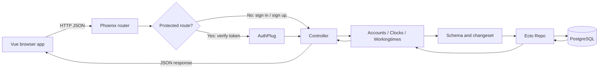
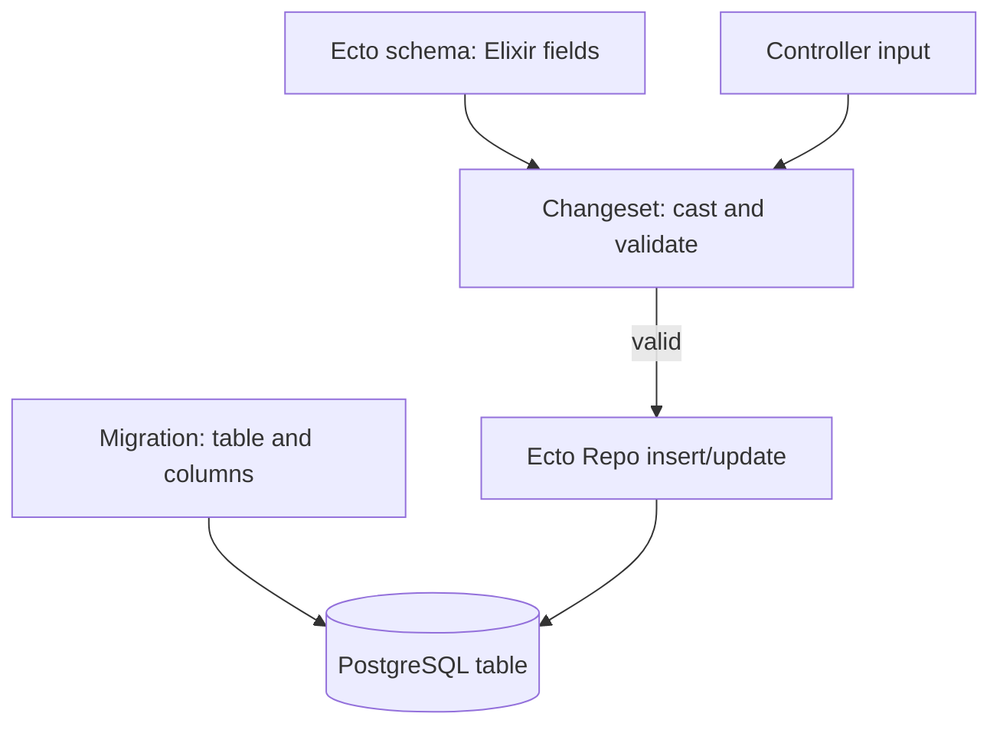
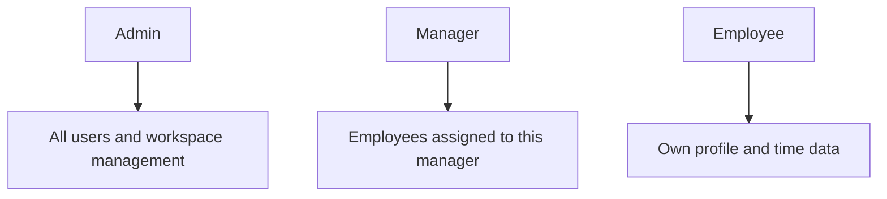
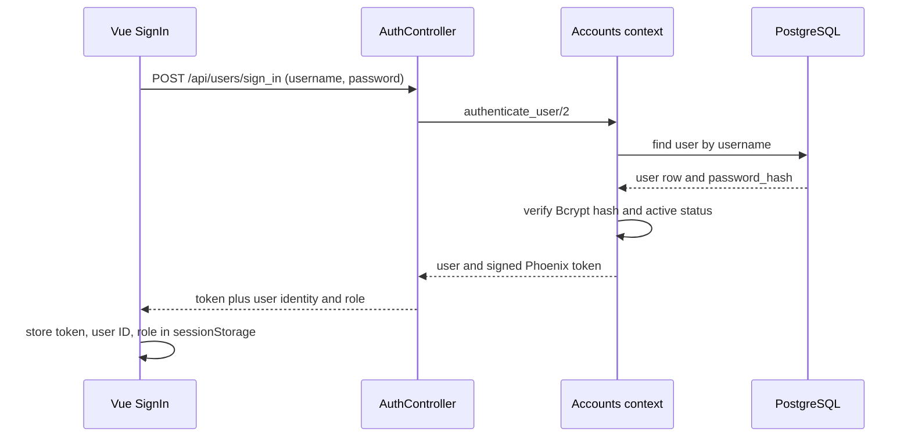

# Time Manager Backend Overview

This guide describes the backend as it exists in the current repository. It explains the main concepts, how a request reaches PostgreSQL and returns, how roles and time tracking work, and where each part of the code lives.

## 1. What the backend does

The backend is a Phoenix JSON API written in Elixir. PostgreSQL stores users, their clock-state history, and completed work or break intervals. The Vue frontend sends HTTP requests; it does not connect to the database directly.



In short: **router → authentication → controller → context → schema/query → Repo → PostgreSQL**. The response travels back as JSON.

## 2. Where the application starts

- `lib/time_manager/application.ex` defines the OTP application and starts the Repo, telemetry, PubSub, and Phoenix endpoint.
- `lib/time_manager_web/endpoint.ex` receives HTTP requests and runs the Phoenix request pipeline.
- `lib/time_manager/repo.ex` configures Ecto's PostgreSQL adapter.
- `config/` contains shared, development, test, production, and runtime settings.

The backend is typically run from `backend/project/` with Mix. In the Docker setup, its Dockerfile and entrypoint are in that project directory; database connection settings are supplied through the environment/configuration.

## 3. Database concepts: migrations, schemas, and rows

A migration changes the database structure. A schema describes those rows to Elixir. A changeset checks data before it is saved.



Current tables and their main purpose:

| Table | Schema | What it records |
| --- | --- | --- |
| `users` | `lib/time_manager/accounts/user.ex` | Login identity, password hash, role, account status, manager assignment, timestamps |
| `clocks` | `lib/time_manager/clocks/clock.ex` | Time-stamped clock transitions and the latest state for each user |
| `workingtime` | `lib/time_manager/workingtimes/workingtime.ex` | Completed work or break intervals with start and end times |

Important migrations under `priv/repo/migrations/`:

- `20260922141401_create_users.exs` creates the original users table.
- `20260922141946_create_clocks.exs` creates clock records.
- `20260922142347_create_workingtime.exs` creates working-time records.
- `20261008110000_add_role_to_users.exs` adds the role field, defaulting to employee.
- `20261008120000_add_status_to_users.exs` adds active/inactive account status.
- `20261008130000_assign_employees_to_managers.exs` adds `manager_id`, a self-reference to the users table, and assigns existing employees across managers.
- `20261008140000_add_break_tracking.exs` adds clock state and work/break kind fields.

Migrations are versioned history. Editing an old migration does not update a database that has already run it; a new migration is normally used for later schema changes.

## 4. User model and role concepts

`TimeManager.Accounts.User` maps a user row to an Elixir struct. Its fields include:

- `username`, `email`, and `full_name` for identity.
- `password` as a virtual field that is accepted during registration but not stored directly.
- `password_hash` for the stored Bcrypt password hash.
- `role`, restricted to `:employee`, `:manager`, or `:admin`.
- `status`, restricted to `:active` or `:inactive`.
- `manager_id`, an optional user ID that assigns an employee to a manager.
- `inserted_at` and `updated_at`, maintained by Ecto timestamps.

`User.changeset/2` validates registration fields and hashes a submitted password. `User.role_changeset/2` is used for role and status changes. The JSON serializer returns the public user fields needed by the frontend, including `role`, `status`, `manager_id`, and `joined_at`.

The intended role model is:



The UI uses these roles to show the corresponding dashboard. The backend also applies role rules to user listing, selected user updates/deletion, and selected time-data reads; see the access-control note below for actions that still need review.

## 5. Authentication lifecycle

Public sign-in and sign-up routes are defined in `lib/time_manager_web/router.ex`. Other API routes use the authenticated pipeline.



For later requests, `src/api.js` on the frontend sends the token in `x-xsrf-token`. `TimeManagerWeb.Plugs.AuthPlug` verifies it through `Accounts.verify_token/1` and assigns the active user to `conn.assigns.current_user`. A missing, invalid, expired, deleted-user, or inactive-user token is rejected.

Sign-out currently returns a success response but does not maintain a token revocation list. The frontend clears its session storage; a copied token remains valid until expiry unless the account becomes inactive or is deleted.

## 6. Contexts: application data operations

Phoenix contexts group database operations by area.

### Accounts — `lib/time_manager/accounts.ex`

Provides user creation and lookup, filtered/sorted user listing, manager team listing, role/status updates, authentication, token verification, access decisions, and user deletion. Deleting a user removes that user's clock and working-time rows inside a database transaction before deleting the user row.

### Clocks — `lib/time_manager/clocks.ex`

Looks up a user's latest clock record, lists clocks, and creates, updates, or deletes clock records. Latest lookup orders by timestamp and then record ID so equal timestamps still have a stable ordering.

### Workingtimes — `lib/time_manager/workingtimes.ex`

Lists a user's work/break intervals, optionally filtering by start and end timestamps, and provides the standard create/update/delete operations. The `Workingtime` changeset accepts only `work` or `break` for `kind`.

## 7. Clock and break state

`ClockController.create/2` uses the latest clock record to determine the next state:

| Action | Current state | New state |
| --- | --- | --- |
| `clock` | `off` | `working` |
| `clock` | `working` | `off` |
| `clock` | `break` | `off` |
| `break` | `working` | `break` |
| `break` | `break` | `working` |
| `break` | `off` | rejected with HTTP 422 |

The legacy boolean `status` remains in the clock row for compatibility: it is true only when the new state is `working`. The `state` string distinguishes `working`, `break`, and `off`.

The frontend separately creates a completed interval in `workingtime` when a work or break segment ends. A work interval has `kind: "work"`; a break interval has `kind: "break"`. The current clock row represents the latest state, while completed intervals provide the history used for daily and weekly summaries.

## 8. Routes and HTTP behavior

All API routes start with `/api`. The router has a public API pipeline and an authenticated pipeline.

| Method | Path | Controller action | Purpose |
| --- | --- | --- | --- |
| `POST` | `/users/sign_up` | `UserController.sign_up` | Register an account; role/status defaults apply |
| `POST` | `/users/sign_in` | `AuthController.sign_in` | Verify credentials and return token/user |
| `POST` | `/users/sign_out` | `AuthController.sign_out` | Return sign-out acknowledgement |
| `GET` | `/users` | `UserController.index` | Admin gets all users; manager gets assigned employees |
| `GET` | `/users/:id` | `UserController.show` | Return a user record |
| `PATCH` / `PUT` | `/users/:id` | `UserController.update` | Admin changes role/status |
| `DELETE` | `/users/:id` | `UserController.delete` | Admin deletes another user and their time rows |
| `GET` | `/clocks/:userID` | `ClockController.show` | Return the latest clock state with a data-access check |
| `POST` | `/clocks/:userID` | `ClockController.create` | Change clock or break state |
| `GET` | `/workingtime/:userID` | `WorkingtimeController.index` | List intervals with a data-access check; optional `start` and `end` filters |
| `POST` | `/workingtime/:userID` | `WorkingtimeController.create` | Create a work/break interval |
| `GET` | `/workingtime/:userID/:id` | `WorkingtimeController.show` | Fetch one interval |
| `PUT` / `PATCH` | `/workingtime/:id` | `WorkingtimeController.update` | Update an interval |
| `DELETE` | `/workingtime/:id` | `WorkingtimeController.delete` | Delete an interval |

Phoenix `resources "/users"` also declares `POST /users`, but the corresponding controller `create/2` implementation is currently commented out. Registration is implemented at `/users/sign_up` instead.

## 9. Example request and response

Employee starts work:

```http
POST /api/clocks/42
Content-Type: application/json
x-xsrf-token: <signed-token>

{"action":"clock"}
```

If the user's current state is `off`, the response contains the new clock record:

```json
{
  "data": {
    "id": 101,
    "time": "2026-10-09T08:30:00Z",
    "status": true,
    "state": "working"
  }
}
```

The dashboard then displays the clock state. When the user clocks out or switches from work to break, the frontend records the interval through `POST /api/workingtime/42`:

```json
{
  "workingtime": {
    "start": "2026-10-09T08:30:00Z",
    "end": "2026-10-09T12:00:00Z",
    "kind": "work"
  }
}
```

## 10. Authorization: implemented behavior and review points

`Accounts.can_access_user_data?/2` grants time-data reads to admins for any user, managers for themselves and their assigned employees, and employees for themselves. The clock `show` and working-time `index` actions call this check.

Some other routes are authenticated but do not currently enforce equivalent ownership checks. In particular, clock creation and working-time create/show/update/delete should be reviewed before relying on them as secure multi-user operations. User `show` is also authenticated but does not currently limit which user's ID can be requested. The role-based router guard in the Vue app is for navigation; API authorization must be enforced server-side.

This distinction matters: having a valid token proves who made the request, but it does not by itself prove that the user may act on the requested user's records.

## 11. JSON serializers

- `lib/time_manager_web/controllers/user_json.ex` shapes user list/detail responses.
- `lib/time_manager_web/controllers/clock_json.ex` shapes clock responses and derives a fallback state for older rows with no state value.
- `lib/time_manager_web/controllers/workingtime_json.ex` returns interval kind, defaulting older rows to `work`.
- `fallback_controller.ex`, `changeset_json.ex`, and `error_json.ex` shape common error responses.

Serializers keep the frontend response format separate from Ecto's internal schema representation.

## 12. Tests and useful commands

Tests are under `test/`, split between context tests and controller tests. Fixtures in `test/support/fixtures/` create test users, clocks, and working-time rows; `test/support/conn_case.ex` and `data_case.ex` provide test setup.

Run commands from `backend/project/`:

```sh
mix test
mix test test/time_manager/accounts_test.exs
mix ecto.migrate
mix run priv/repo/seeds.exs
```

The test suite should be updated alongside authorization and state-transition changes, especially for cross-user access and inactive accounts.

## 13. File map

| Concern | Main files |
| --- | --- |
| Startup/configuration | `lib/time_manager/application.ex`, `lib/time_manager/repo.ex`, `config/` |
| Users and authentication | `lib/time_manager/accounts.ex`, `lib/time_manager/accounts/user.ex`, `lib/time_manager_web/controllers/auth_controller.ex`, `auth_plug.ex` |
| HTTP routes and user API | `lib/time_manager_web/router.ex`, `user_controller.ex`, `user_json.ex` |
| Clock state | `lib/time_manager/clocks.ex`, `clocks/clock.ex`, `clock_controller.ex`, `clock_json.ex` |
| Work/break records | `lib/time_manager/workingtimes.ex`, `workingtimes/workingtime.ex`, `workingtime_controller.ex`, `workingtime_json.ex` |
| Database changes | `priv/repo/migrations/` |
| Tests and fixtures | `test/`, `test/support/fixtures/` |

