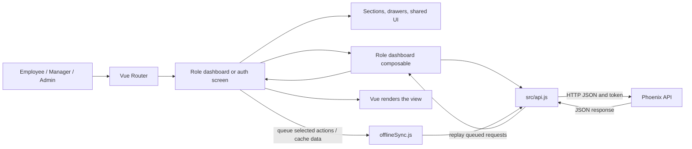
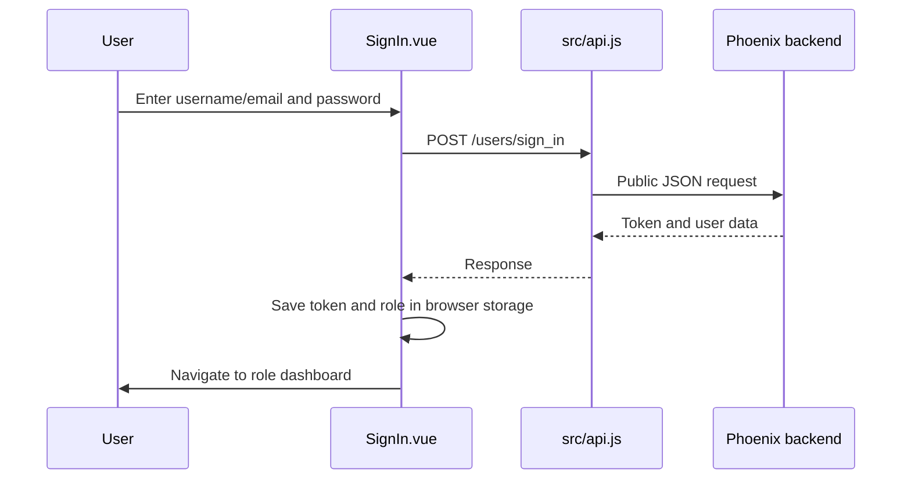
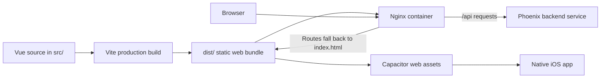

# Frontend Architecture and File Guide

This guide maps the current frontend folders and files to their jobs. The app is a Vue single-page application built with Vite, served as static files by Nginx, and packaged for iOS with Capacitor.

## How the app fits together



The frontend owns navigation, presentation, local interaction state, and API calls. The Phoenix backend remains responsible for validating permissions and storing data. The browser app never connects directly to PostgreSQL.

## Project folder and file tree

The tree lists the current project files and source modules. Dependency folders, generated `dist/` output, local Xcode build products, and ignored/untracked local files are omitted.

```text
frontend/project/
├── .dockerignore                         # Omits dependencies, builds, Git data, and local env files from Docker context
├── .gitignore                             # Ignores generated builds, dependencies, logs, and local files
├── .vscode/
│   └── extensions.json                    # Recommends Vue editor support
├── Dockerfile                             # Builds the Vite app and copies it into Nginx
├── .github/
│   └── workflows/
│       └── main.yml                       # Mirrors repository changes to configured Git remotes
├── README.md                              # Project setup and common commands
├── architecture.md                        # This folder and architecture guide
├── capacitor.config.json                  # Capacitor app identity and web output directory
├── frontend_overview.md                    # Product screens and frontend behavior overview
├── index.html                              # Browser document shell and Vue mount element
├── jsconfig.json                           # JavaScript and editor configuration
├── nginx.conf                              # Serves the app and forwards /api requests to Phoenix
├── package.json                            # NPM scripts and direct dependencies
├── package-lock.json                       # Locked NPM dependency versions
├── vite.config.js                          # Vue/Vite plugins, dev API proxy, and @ source alias
├── public/
│   └── favicon.ico                         # Static browser tab icon
├── src/
│   ├── App.vue                             # Root component, router outlet, offline badge, and sync overlay
│   ├── api.js                              # Axios client, API URL selection, and authentication header
│   ├── main.js                             # Imports global styles and mounts Vue with the router
│   ├── offlineSync.js                      # Network state, offline request queue, cache, and replay
│   ├── router.js                           # URL routes and browser-side authentication/role redirects
│   ├── assets/
│   │   ├── main.css                        # Global theme variables, typography, and base styles
│   │   └── styles/
│   │       ├── auth.css                    # Shared sign-in and sign-up styling
│   │       └── dashboard.css               # Shared dashboard surfaces, headings, and profile styling
│   ├── components/
│   │   ├── admin/
│   │   │   ├── AdminDashboard.vue          # Admin shell, navigation, and state coordination
│   │   │   ├── sections/
│   │   │   │   ├── AdminTeamsSection.vue    # Manager teams and unassigned employees
│   │   │   │   ├── AdminUsersSection.vue    # Search, filters, user list, and account actions
│   │   │   │   └── AdminProfileSection.vue  # Admin profile and logout view
│   │   │   └── drawers/
│   │   │       ├── AdminRoleEditorDrawer.vue # User role selection and confirmation
│   │   │       └── AdminStatisticsDrawer.vue # User/team hours, assignment, and email panel
│   │   ├── manager/
│   │   │   ├── ManagerDashboard.vue          # Manager shell, navigation, and state coordination
│   │   │   ├── sections/
│   │   │   │   ├── ManagerOverviewSection.vue # Live team status and work-hour summary
│   │   │   │   ├── ManagerTeamSection.vue     # Assigned and unassigned employee lists
│   │   │   │   └── ManagerProfileSection.vue  # Manager profile and logout view
│   │   │   └── drawers/
│   │   │       └── ManagerMemberDetailsDrawer.vue # Member hours, status, team action, and email panel
│   │   ├── employee/
│   │   │   ├── Home.vue                       # Employee shell, navigation, and state coordination
│   │   │   └── sections/
│   │   │       ├── EmployeeOverviewSection.vue # Clock controls and daily/weekly summaries
│   │   │       ├── EmployeeTimesSection.vue    # Completed work and break records
│   │   │       ├── EmployeeFeedbackSection.vue # Feedback email draft form
│   │   │       └── EmployeeProfileSection.vue  # Employee profile and logout view
│   │   ├── auth/
│   │   │   ├── AuthBrandPanel.vue             # Shared sign-in/sign-up branding panel
│   │   │   ├── SignIn.vue                     # Login form and local session setup
│   │   │   └── SignUp.vue                     # New employee registration form
│   │   ├── dashboard/
│   │   │   ├── AppNavItem.vue                 # One reusable dashboard navigation item
│   │   │   ├── AppShell.vue                   # Shared dashboard frame, sidebar, and mobile navigation
│   │   │   └── WeeklyHoursChart.vue             # Reusable weekly work-hours chart
│   │   └── shared/
│   │       └── InitialAvatar.vue              # Initials avatar with tone variants
│   ├── composables/
│   │   ├── useAdminDashboard.js                # Admin profile, users, role/status, teams, and statistics operations
│   │   ├── useEmployeeDashboard.js             # Employee profile, clock, intervals, manager, and cache operations
│   │   └── useManagerDashboard.js              # Manager profile, team, member data, and assignment operations
│   └── utils/
│       ├── emailDraft.js                      # Validates and builds encoded mailto links
│       ├── identity.js                        # Display names, initials, and avatar tone helpers
│       └── time.js                            # Shared date ranges, work duration, and date/time formatting
└── ios/
    ├── .gitignore                             # Ignores Xcode and native build outputs
    ├── debug.xcconfig                         # Enables Capacitor debug mode for iOS
    └── App/
        ├── App.xcodeproj/
        │   ├── project.pbxproj                # iOS targets, build phases, signing, and resources
        │   └── project.xcworkspace/
        │       └── xcshareddata/
        │           ├── IDEWorkspaceChecks.plist # Shared Xcode workspace checks
        │           └── swiftpm/Package.resolved # Locked Swift package versions
        ├── App/
        │   ├── AppDelegate.swift              # iOS lifecycle and Capacitor event forwarding
        │   ├── Info.plist                      # iOS app metadata and platform settings
        │   ├── SceneDelegate.swift             # Creates the Capacitor bridge view
        │   ├── Base.lproj/
        │   │   ├── LaunchScreen.storyboard     # Native launch screen
        │   │   └── Main.storyboard             # Storyboard with Capacitor bridge controller
        │   └── Assets.xcassets/                # App icon, splash images, and asset metadata
        └── CapApp-SPM/
            ├── .gitignore                      # Ignores local Swift package state
            ├── Package.swift                   # Capacitor and plugin package dependencies
            ├── README.md                       # Notes that Capacitor manages this package
            └── Sources/CapApp-SPM/CapApp-SPM.swift # Marker module for the package target
```

Each dashboard, section, and drawer is a Vue single-file component. Its template, script, and component-specific style live together in the `.vue` file. Shared styles used across screens remain under `src/assets/`.

## Startup and routes

`index.html` supplies the `#app` mount point. `src/main.js` imports the global, authentication, and dashboard stylesheets, installs Vue Router, and mounts `App.vue`. The root component renders the current route and subscribes to offline-sync state.

The router maps `/` to employee home, `/manager` to the manager dashboard, `/admin` to the admin dashboard, `/login` to sign-in, and `/sign_up` to registration. `/sign_in` redirects to `/login`. A navigation guard checks for a locally stored token and sends authenticated users to the dashboard matching their stored role. This is a browser navigation convenience; the backend still enforces access for every protected API request.

## Components and styling

- `AppShell.vue` provides the shared responsive dashboard frame, navigation, account controls, and slot for each role’s content. `AppNavItem.vue` renders a navigation item.
- The employee, manager, and admin dashboard components coordinate page state and connect their composables to reusable sections and drawers.
- `SignIn.vue` and `SignUp.vue` are authentication screens. `AuthBrandPanel.vue` shares their branded panel.
- `InitialAvatar.vue` and `WeeklyHoursChart.vue` are reusable visual components.
- Component-specific styles are kept in each component’s `.vue` file. `main.css` supplies global foundations; `assets/styles/auth.css` and `assets/styles/dashboard.css` hold styles shared by multiple screens.

## Data and API flow

`src/api.js` creates the Axios client. It chooses an API base URL from a saved override, native platform defaults, or the browser host, and attaches the `x-xsrf-token` header to protected calls. Sign-in and sign-up requests are treated as public. The backend decides whether the caller may access the requested data.

The three dashboard composables keep data operations out of the view components:

- `useEmployeeDashboard.js` handles employee profile, clock, work interval, manager, and local-cache operations.
- `useManagerDashboard.js` handles the manager profile, team lists, member clock/time information, and assignments.
- `useAdminDashboard.js` handles user lists, account role/status operations, team assignment, and admin statistics data.

The Vue dashboard components retain UI state such as the active section, filters, selected drawer, and in-progress messages. They pass data and callbacks to section/drawer components through props and emitted events.

## Offline behavior

`src/offlineSync.js` listens for browser and Capacitor network changes, stores queued API actions in a local FIFO queue, caches selected dashboard data in local storage, and replays queued requests after reconnection. The employee dashboard queues clock actions while offline; the employee composable also reads cached profile and time data. `App.vue` subscribes to connectivity/sync state and displays an offline badge or synchronization overlay. Native haptics are used where available.

Offline support is selective: the app does not make every API operation available offline. For example, manager/admin data loading and account changes still need a working API connection.

## Main user flows

### Sign in



### Employee clocks or starts a break

The employee dashboard calls its composable, which uses `src/api.js` to request the latest state and send clock actions. If the device is offline, supported actions are queued by `offlineSync.js` and replayed in order after reconnection. The screen updates from the result. Completed work or break intervals are sent through the working-time API as separate records.

### Manager or admin loads team data

The manager composable loads the manager’s team and the clock/time data used by its overview and member detail panel. The admin composable loads users, manager assignments, and data shown in its teams, user management, and statistics views. Backend access rules determine which results or changes the caller may receive.

## Build and hosting



`npm run build` compiles the app into `dist/`. The Dockerfile builds the bundle in Node and serves it from Nginx. `nginx.conf` serves client-side routes through `index.html` and forwards `/api/` requests to the `phoenix` service. Capacitor uses the same `dist/` bundle for its iOS wrapper.

## Configuration files and commands

- `package.json` declares Vue, Vue Router, Axios, Capacitor plugins, Vite, and development scripts. `package-lock.json` records resolved NPM versions.
- `vite.config.js` configures the Vue and Vue DevTools plugins, development proxy to `http://localhost:4000`, and the `@` alias for `src/`.
- `jsconfig.json` configures JavaScript editor tooling. `.vscode/extensions.json` recommends Vue language support.
- `capacitor.config.json` sets the native app ID/name and points Capacitor at `dist/`.
- `.github/workflows/main.yml` configures repository mirroring on push/delete; it does not build or deploy this app.
- `README.md` contains project setup notes; `frontend_overview.md` explains the user-facing screens and behaviors.

Run these from `frontend/project/`:

```sh
npm install       # Install JavaScript dependencies
npm run dev       # Start Vite's development server
npm run build     # Compile the production bundle into dist/
npm run preview   # Serve the built bundle locally
```

The iOS wrapper is built through Xcode and Capacitor using the web bundle in `dist/` and native project under `ios/App/`.
