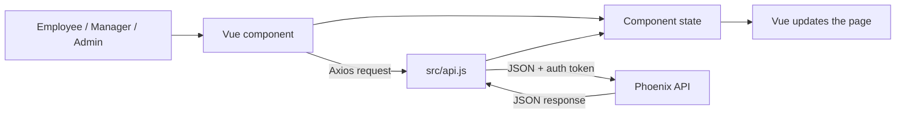
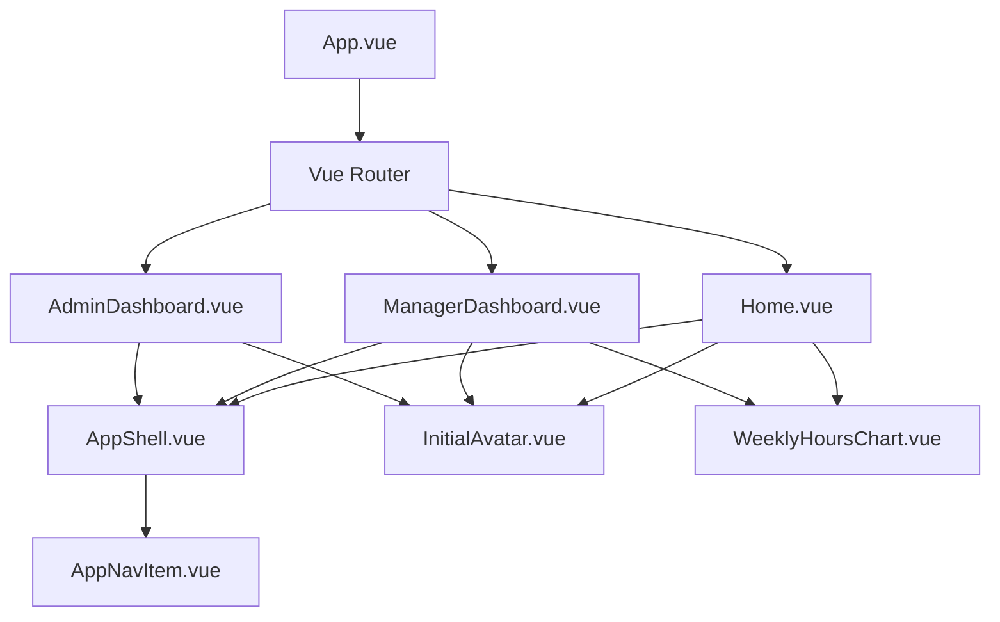
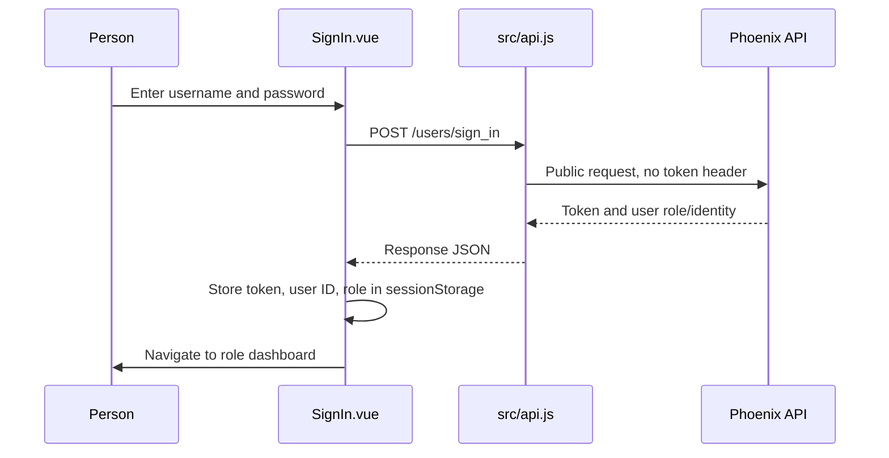
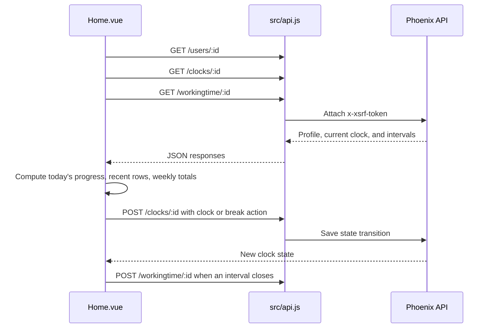
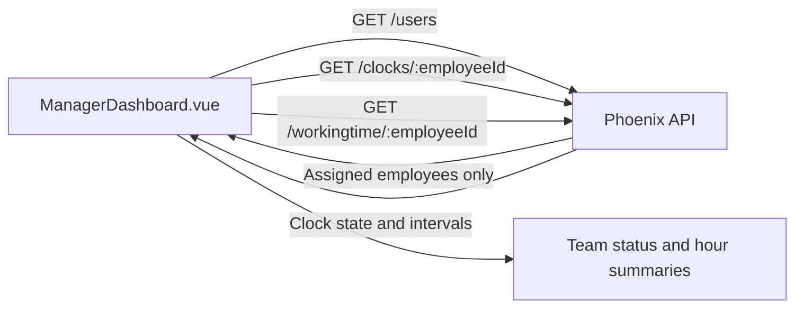

# Time Manager Frontend Overview

This guide explains how the current Time Manager web app is structured and how its employee, manager, and administrator screens use the backend. The app is a Vue 3 single-page application built with Vite. It uses Axios for HTTP requests and CSS in Vue components plus a shared stylesheet for its light, responsive interface.

## 1. What the frontend does

The frontend presents role-specific screens and turns user actions into API requests. It does not read or write PostgreSQL directly.



For example, an employee clicking **Break** calls the clock API. The response updates the screen's current state, and when the work segment ends the frontend also saves that completed interval as a break or work record.

## 2. Starting point and route structure

- `src/main.js` imports the global CSS, creates the Vue application, and mounts it into `index.html`.
- `src/App.vue` is the root component and displays the route selected by Vue Router using `<router-view />`.
- `src/router.js` maps URLs to screens and checks whether a protected page has a token in browser session storage.

| Path | Component | Intended role |
| --- | --- | --- |
| `/` | `Home.vue` | Employee |
| `/manager` | `ManagerDashboard.vue` | Manager |
| `/admin` | `AdminDashboard.vue` | Administrator |
| `/login` | `SignIn.vue` | Signed-out user |
| `/sign_up` | `SignUp.vue` | New account |
| `/sign_in` | Redirects to `/login` | Legacy route alias |

The router reads `xsrfToken` and `role` from `sessionStorage`; based on role it sends signed-in users to `/`, `/manager`, or `/admin`. This keeps navigation aligned with the user's role. The backend remains responsible for enforcing access to data and actions.

## 3. Shared design and components

All three authenticated dashboards use the same page shell so navigation and account controls stay consistent while the page content changes.



Reusable files:

- `src/components/dashboard/AppShell.vue` lays out the sidebar/navigation, page content, and profile/logout area. It receives the current navigation items and active tab from its parent.
- `src/components/dashboard/AppNavItem.vue` renders a single navigation item.
- `src/components/shared/InitialAvatar.vue` creates a colored initials avatar from a person's display name.
- `src/components/dashboard/WeeklyHoursChart.vue` draws weekly hours for employee and manager views.
- `src/utils/identity.js` shares display-name, initials, and avatar-tone helpers.
- `src/assets/main.css` contains the global light theme, shared design variables, typography, and base styles. `src/assets/styles/auth.css` shares sign-in/sign-up styling, and `src/assets/styles/dashboard.css` centralizes common dashboard surfaces, headings, and profile styling. Dashboard-specific layout and content rules are in `Home.css`, `ManagerDashboard.css`, and `AdminDashboard.css`, beside their Vue views.
- `src/components/auth/AuthBrandPanel.vue` is used by sign-in and sign-up screens for the authentication brand area.

## 4. Sign-in, sign-up, and browser session

### Sign-in flow



`SignIn.vue` accepts the token/user response and stores the session values. `router.js` uses those values for route selection. The role decides which dashboard the browser opens; API permissions are checked separately by the server.

### Sign-up flow

`SignUp.vue` collects full name, username, email, and password, then sends them to `POST /users/sign_up`. The backend creates a regular employee account by default. After success, the page navigates to sign-in.

### Logout flow

Dashboard components call the sign-out endpoint, clear session storage, and navigate to `/login`. The current backend sign-out endpoint acknowledges the request; the browser clearing its token is what ends the local session.

## 5. Employee experience: `Home.vue`

The employee screen uses three navigation sections: Home, My Times, and Profile.

### Home dashboard

- Greeting and current date based on the browser's local time.
- Current clock state, elapsed time, and clock in/out button.
- Break button while clocked in; it starts a break or resumes work.
- Today's worked time and progress toward an 8-hour target.
- Weekly-hours chart and recent work/break entries.

### My Times

Shows the employee's recorded work and break intervals, including type, date, start, end, and duration. A refresh action reloads the dashboard data.

### Profile

Shows the signed-in user's name, email, and role, with a separate logout button.

### Employee data flow



The page stores its profile, clock state, work-time rows, loading state, and active tab in Vue component state. It periodically updates a local clock value so the displayed elapsed duration can advance without repeatedly writing clock records.

## 6. Manager experience: `ManagerDashboard.vue`

The manager screen shows the team assigned to the signed-in manager. It presents a team overview, weekly team hours, and a team-member table with current status, today's hours, weekly hours, and a view action. A separate Profile section shows manager details and logout.

Data loading works as follows:

1. Request the manager profile from `GET /users/:id`.
2. Request `GET /users`; the backend returns only employees assigned to this manager.
3. For each returned employee, request their latest clock and work-time rows.
4. Derive the displayed working/off-clock/on-break status and daily/weekly totals in the frontend.



The manager dashboard calculates totals from the returned interval data. It does not currently receive a pre-aggregated team report from a dedicated backend endpoint.

## 7. Administrator experience: `AdminDashboard.vue`

The administrator screen has Teams, User management, and Profile sections.

- **Teams:** groups employees under managers using each user's `manager_id`; employees without a manager appear separately.
- **User management:** loads the user list, supports name/email search and role/status filters, and displays role, account status, joined date, and actions.
- **Edit role:** opens a drawer with Employee, Manager, and Admin choices; saving sends a role update.
- **Suspend/activate:** sends a status update. Inactive accounts are denied by backend login and token checks.
- **Delete:** asks for confirmation and calls the admin delete endpoint. Backend deletion removes that user's clock and working-time rows too.
- **Profile:** displays admin identity and provides logout.

User records are read from the database through the API; table entries are not static sample users in the component. Formatting such as role labels, initials, and dates is applied in the frontend.

## 8. API client: `src/api.js`

Axios is configured with the backend base URL `http://localhost:4000/api`. A request interceptor:

1. Identifies sign-in/sign-up as public endpoints.
2. Reads `xsrfToken` from browser session storage for other calls.
3. Adds it as the `x-xsrf-token` header, if available.

The API host is currently hard-coded to localhost in this file. For a deployed environment, it should be configured for the target backend URL, usually through a Vite environment variable.

Common calls:

| Frontend use | Request |
| --- | --- |
| Sign in | `POST /users/sign_in` |
| Register | `POST /users/sign_up` |
| Load profile/user list | `GET /users/:id`, `GET /users` |
| Clock in/out and break | `GET /clocks/:userID`, `POST /clocks/:userID` |
| Read/create intervals | `GET /workingtime/:userID`, `POST /workingtime/:userID` |
| Admin role/status changes | `PATCH /users/:id` |
| Admin delete | `DELETE /users/:id` |

## 9. Responsive design and styling

The app keeps the same content and components across window sizes. Responsive CSS rearranges or compresses navigation, tables, cards, and controls to fit narrower screens; it is not a separate mobile application. The current visual system is light themed, with shared colors, borders, typography, radii, and shadows.

When changing a component, prefer the existing global variables and shared components so employee, manager, and admin views remain visually consistent.

## 10. Project commands

Run from `frontend/project/`:

```sh
npm run dev
npm run build
npm run preview
```

- `dev` starts the Vite development server.
- `build` creates the production bundle in the configured build output directory.
- `preview` serves a local preview of the built bundle.

## 11. Quick file map

| File | Responsibility |
| --- | --- |
| `src/main.js` | Vue entry point |
| `src/App.vue` | Root router outlet |
| `src/router.js` | Route definitions and browser-side role redirect |
| `src/api.js` | Axios setup and auth header |
| `src/components/admin/AdminDashboard.vue` | Team and user administration |
| `src/components/admin/AdminDashboard.css` | Administrator-only layout and content styling |
| `src/components/manager/ManagerDashboard.vue` | Manager team view and summaries |
| `src/components/manager/ManagerDashboard.css` | Manager-only layout and content styling |
| `src/components/employee/Home.vue` | Employee clock, break, time, chart, and profile UI |
| `src/components/employee/Home.css` | Employee-only layout and content styling |
| `src/components/auth/SignIn.vue` | Login form/session storage |
| `src/components/auth/SignUp.vue` | Account registration form |
| `src/components/dashboard/AppShell.vue` | Shared dashboard layout/navigation |
| `src/components/dashboard/WeeklyHoursChart.vue` | Shared weekly chart |
| `src/components/shared/InitialAvatar.vue` | Reusable initials avatar |
| `src/assets/main.css` | Global theme and base styles |
| `src/assets/styles/auth.css` | Shared sign-in and sign-up styling |
| `src/assets/styles/dashboard.css` | Shared employee, manager, and admin dashboard styling |

